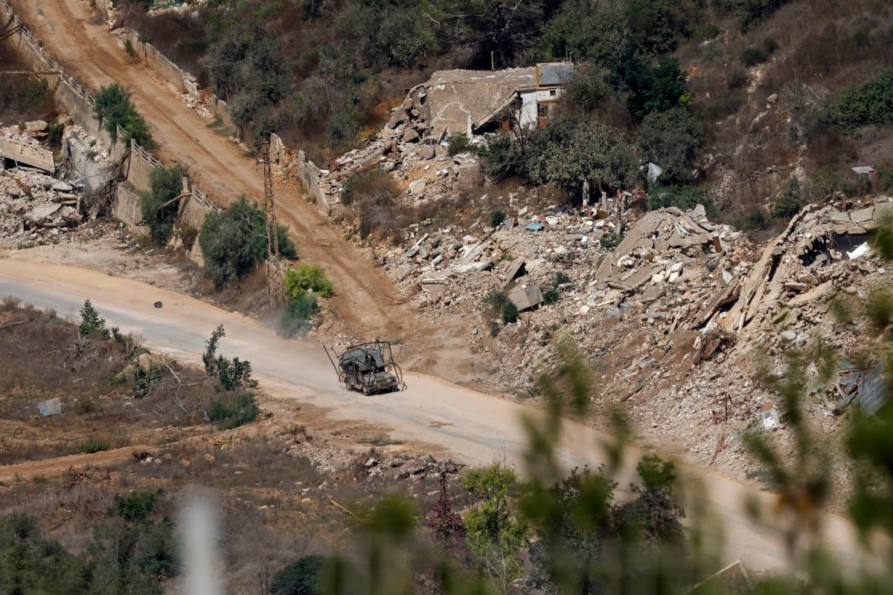

# 8 Israeli soldiers wounded in southern Lebanon ‘vehicle collision’

- LONDON: Eight Israeli soldiers were wounded on Saturday when two military vehicles collided in southern Lebanon, the Israeli military said.
- The crash took place near the Lebanese village of Rab Al-Thalathine, according to an initial military investigation cited by Israeli media.
- Six of the soldiers were taken to hospital for treatment.

## Story

LONDON: Eight Israeli soldiers were wounded on Saturday when two military vehicles collided in southern Lebanon, the Israeli military said.

The crash took place near the Lebanese village of Rab Al-Thalathine, according to an initial military investigation cited by Israeli media. Six of the soldiers were taken to hospital for treatment.

The military described the collision as an apparent accident and said it was investigating the circumstances.

It came a day after two other Israeli service members were wounded in an “operational accident” involving a grenade explosion during military activity in southern Lebanon.

- Source: Arab News
- Related: [[Israeli forces blow up school, burn homes in southern Lebanon, Lebanese]], [[Israel carries out controlled explosions on Houla in southern Lebanon]], [[Israeli forces prevent Palestinians from reaching olive groves]]

Back to [[Middle East]].
