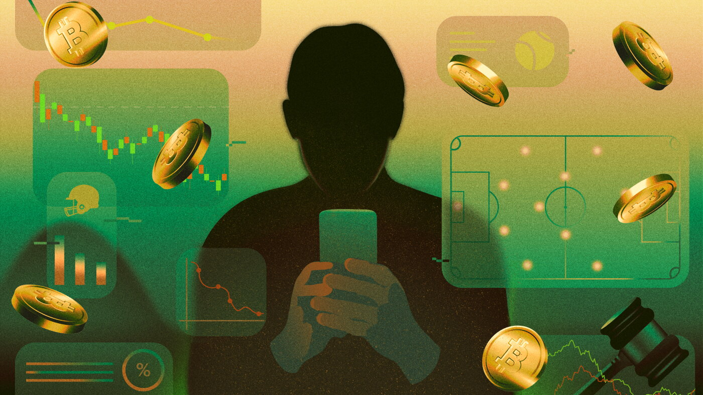

# After bankruptcy, he was banned from sports betting sites. Then he

- The dark side of the prediction market boom is becoming more clear: Experts say the sites have become go-to outlets for gambling addicts to relapse as the companies avoid state consumer protections.

## Story

During the pandemic, Thomas thought he would give DraftKings and FanDuel a try. Before long, he formed a habit.

"I could have ten drinks one night and then be fine with not drinking again for a year," said Thomas, 35, who asked to be identified by his middle name fearing his problem gambling history could affect his career. "But sports gambling was different. It really got me."

He never cared much for sports. Yet betting on games seemed like an easy way to make a buck. He started placing wagers on football and tennis mostly using parlays, which are difficult-to-win bets that require multiple things happening in one game in order to land an enticing payout.

Working from his home in Pennsylvania in the financial services industry, Thomas says there were few moments when he didn't have one eye on placing a bet as he juggled work emails and meetings.

- Source: NPR

Back to [[Technology News]].
