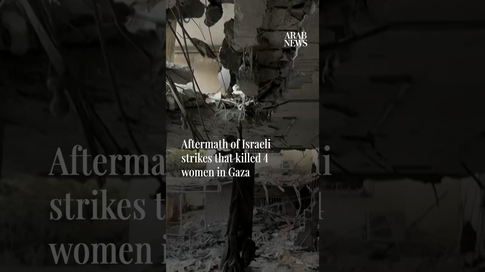

# Aftermath of Israeli strikes that killed 4 women in Gaza

[video](youtube:SHvQysvCQUs)

- Palestinians go through the rubble of their building in northern Gaza after an overnight Israeli strike left five people dead, according to the Gaza Civil Defense and Gaza City's Al-Shifa hospital

- Source: Arab News
- Related: [[Israeli forces blow up school, burn homes in southern Lebanon, Lebanese]], [[8 Israeli soldiers wounded in southern Lebanon ‘vehicle collision’]]

Back to [[Video]].
