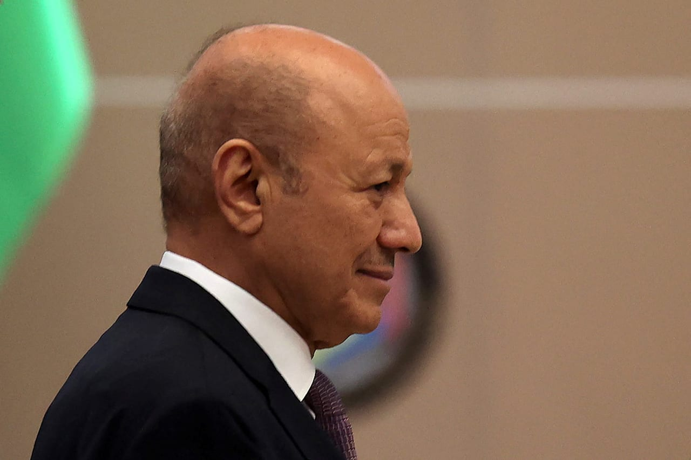

# Al-Alimi announces launch of military operations against Houthi militias

- RIYADH: The President of Yemen’s Presidential Leadership Council Rashad Mohammed Al-Alimi announced the launch of military operations to recapture the country’s remaining territories controlled by the Houthis on Sunday.
- “Today we are embarking on a decisive phase in the history of our nation,” Al-Alimi said, adding that the state had made “great sacrifices” in choosing the path of peace.

## Story

RIYADH: The President of Yemen’s Presidential Leadership Council Rashad Mohammed Al-Alimi announced the launch of military operations to recapture the country’s remaining territories controlled by the Houthis on Sunday.

“Today we are embarking on a decisive phase in the history of our nation,” Al-Alimi said, adding that the state had made “great sacrifices” in choosing the path of peace.

Al-Alimi said the operations were aimed at restoring security, rights and dignity to citizens in areas controlled by the Houthis, stressing that those citizens were not targets of the military operations.

He called on residents in militia-controlled areas to stay away from Houthi gathering places and to protect their children from being drawn into the fighting.

- Source: Arab News
- Related: [[Yemen Army carries out 257 precision operations against Houthis]], [[Yemeni forces repel major Houthi assaults in Taiz, strike targets in]], [[Saudi project clears 1,256 mines in Yemen]]

Back to [[Middle East]].
