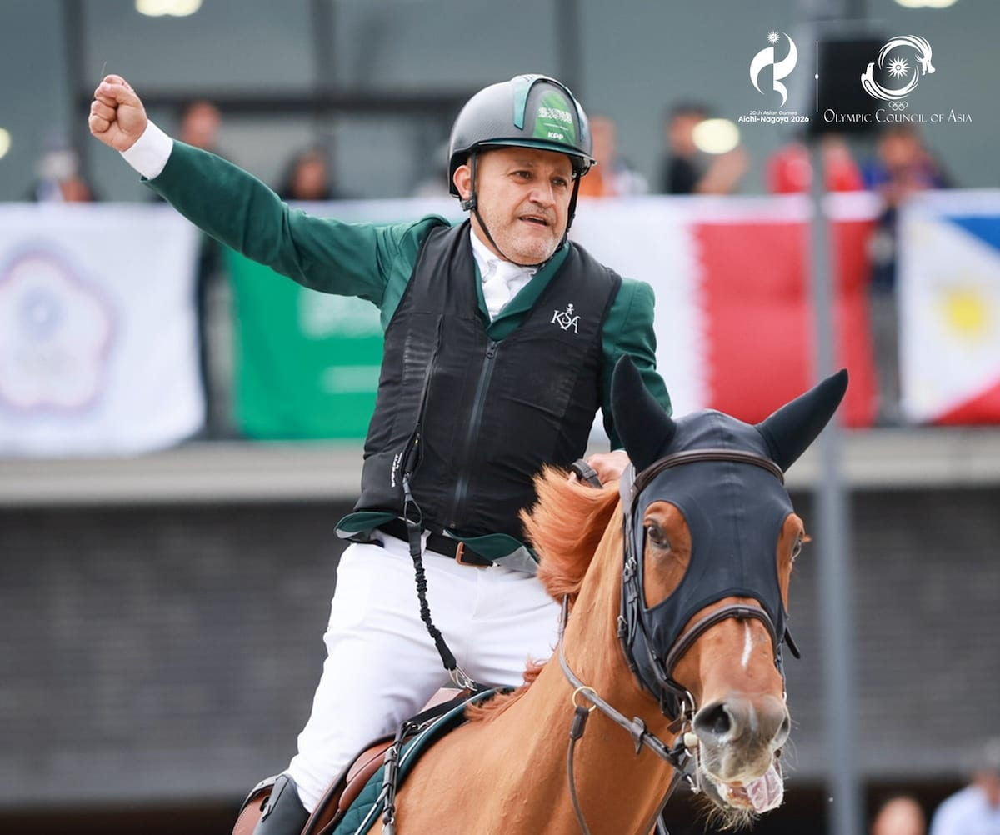

# Al-Dahami grabs show jumping gold as Saudi Arabia ends Asian Games with

- At the 20th Asian Games in Japan, Saudi Arabia concluded its participation with a record total of 17 medals, including four gold, three silver, and ten bronze, marking their best performance since their debut in 1982.
- Ramzi Al-Dahami's victory in individual show jumping on the final day contributed significantly, and noteworthy achievements included jiu-jitsu golds for brothers Omar and Abdullah Nada, as well as the Kingdom's first adult medal for a female athlete, Dina Ahmed Mustafa, in karate.

## Story

DUBAI: The Saudi delegation participating in the 20th Asian Games, which concluded on Sunday in Japan, has achieved 18th place in the final overall ranking of the tournament with 17 medals, after Ramzi Al-Dahami grabbed a last-day win in show jumping.

The four gold, three silver and 10 bronze medals mark the highest tally of awards since Saudi Arabia’s first-ever participation in 1982.

The Kingdom’s gold medals were achieved by Omar Nada in jiu-jitsu (under 94 kg); Abdullah Tariq Nada in jiu-jitsu (under 85 kg); Ramzi Al-Dahami, Khalid Al-Mubti, Abdul Rahman Al-Rajhi and Saad Al-Ajmi in the equestrian competition (show jumping — team category); and Ramzi Al-Dahami in equestrian (show jumping — individual category).

The total of 17 medals surpasses the previous best of 14, achieved in Doha in 2006 with eight gold and six bronze.

- Source: Arab News
- Related: [[UAE tops Asian Games jiu-jitsu standings with record 5 golds]], [[Bahrain tops Arab nations at Asian Games with 22 medals]], [[Saudi and Moroccan Derbies take Kings League MENA centerstage as Ultra]]

Back to [[Sport]].
