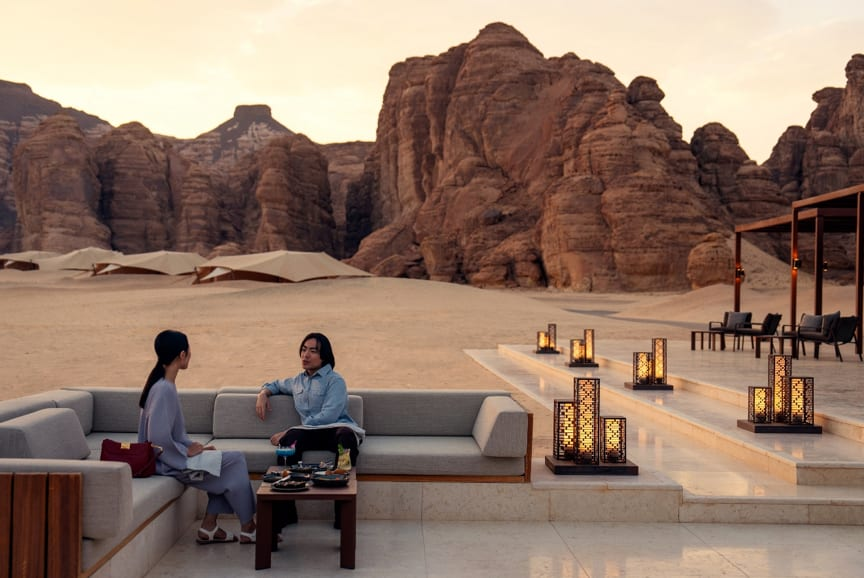

# AlUla expands global travel network with 7 new destination management

- AlUla has expanded its Preferred Destination Management Company Program by adding seven new partners, increasing its total network to 19 to boost international tourism.
- The new DMCs will assist with travel planning and operations across various global markets, and this expansion coincides with infrastructure improvements at AlUla International Airport, which has increased its capacity to accommodate more visitors.

## Story

RIYADH: AlUla has added seven destination management companies to its Preferred DMC Program, expanding its network to 19 travel partners as Saudi Arabia seeks to attract more international visitors to the heritage destination.&nbsp;

Destination management companies, or DMCs, work with travel agencies and tour operators to organize trips, arrange itineraries and provide on-the-ground services for visitors.&nbsp;

The new partners are ROAM, RIDA International, 88 Destinations, Onedar, Desert Adventures, Arabia Explorer, and Young Life. They will support travel bookings, itinerary planning and local operations across markets including Europe, the Gulf, the US, Asia, Latin America and China.&nbsp;

The seven companies join 12 existing partners and will cover major source markets across Europe, the Gulf, North America and Asia, with Young Life focused specifically on China

- Source: Arab News
- Related: [[Saudi project clears 1,256 mines in Yemen]], [[GCC tops global remittance outflows at $161bn]], [[Saudi tourism facilities expand 18 percent as hospitality supply grows]]

Back to [[Saudi Arabia]].
