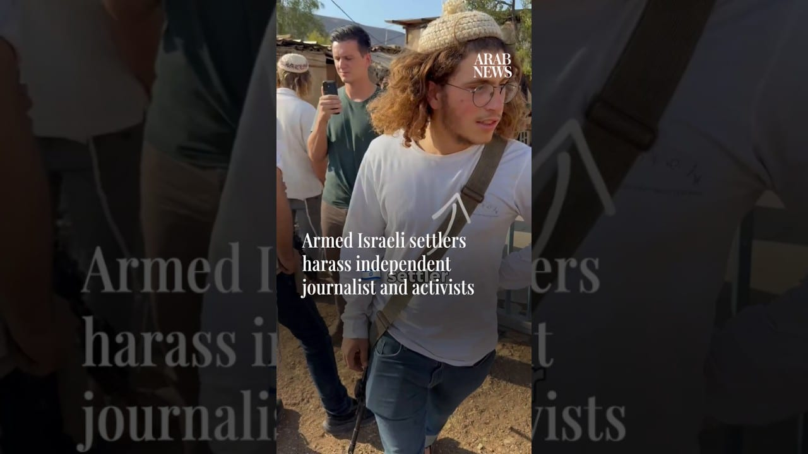

# Armed Israeli settlers harass independent journalist and activists

[video](youtube:-oPR4bwL5Vo)

- Independent journalist Andrey Khrzhanovskiy shared a video on Saturday that he said showed Israeli settlers harassing Palestinians and activists in the West Bank village of Duma.
- Palestinian media reported that international activists accompanying a journalist confronted the settlers, asking why they had arrived at a local family’s home carrying rifles while Palestinian civilians were unarmed.

- Source: Arab News
- Related: [[Israeli forces fire tear gas at Palestinians after settlers reportedly]], [[Armed Israeli settler tries to break into Palestinian home]], [[Israeli forces prevent Palestinians from reaching olive groves]]

Back to [[Video]].
