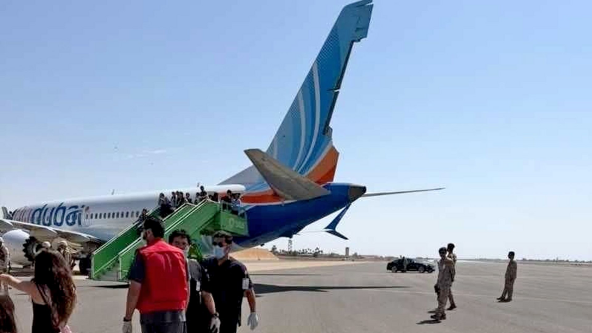

# Australia investigating Flydubai co-pilot's links to country

- State police and the country's security agency are looking into the co-pilot, who attempted to take control of a Flydubai plane travelling to Israel.

- Source: BBC

Back to [[World News]].
