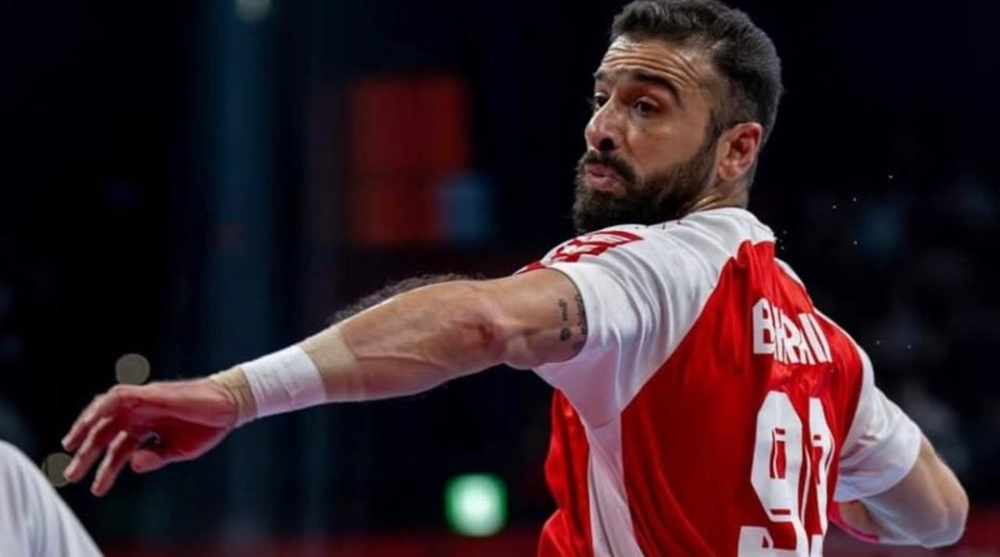

# Bahrain tops Arab nations at Asian Games with 22 medals

- Bahrain finished as the highest-ranked Arab nation at the Aichi-Nagoya 2026 Asian Games after winning 22 medals, including 11 golds, five silvers and six bronzes.
- The kingdom’s strongest performance came in athletics, which accounted for 13 of its medals, including nine golds, two silvers and two bronzes, as Bahrain made its mark across a range of sports at the Games in Japan.
- Bahrain’s men’s handball team also secured a historic first Asian Games gold after beating Qatar 33-32 in the final.

## Story

LONDON: Bahrain finished as the highest-ranked Arab nation at the Aichi-Nagoya 2026 Asian Games after winning 22 medals, including 11 golds, five silvers and six bronzes.

The kingdom’s strongest performance came in athletics, which accounted for 13 of its medals, including nine golds, two silvers and two bronzes, as Bahrain made its mark across a range of sports at the Games in Japan.

Bahrain’s men’s handball team also secured a historic first Asian Games gold after beating Qatar 33-32 in the final.

The victory marked a breakthrough for the team, which had reached the final at each of the previous two editions without winning the title.

- Source: Arab News
- Related: [[UAE tops Asian Games jiu-jitsu standings with record 5 golds]], [[Al-Dahami grabs show jumping gold as Saudi Arabia ends Asian Games with]], [[Israeli forces blow up school, burn homes in southern Lebanon, Lebanese]]

Back to [[Sport]].
