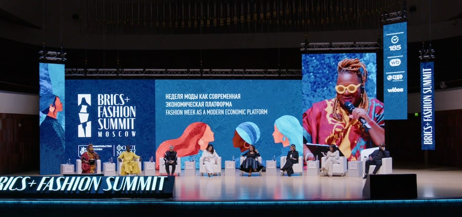

# Beyond the runway BRICS+ Fashion Summit panel calls for fashion weeks to

- MOSCOW: The runways may command the spotlight, but the impact of fashion weeks is measured by what happens after the shows end, speakers at the BRICS+ Fashion Summit have said.
- From business deals to new industry opportunities, the event’s lasting economic value was the focus of the panel “Fashion week as a modern economic platform” at Moscow’s Zaryadye Concert Hall.

## Story

MOSCOW: The runways may command the spotlight, but the impact of fashion weeks is measured by what happens after the shows end, speakers at the BRICS+ Fashion Summit have said.

From business deals to new industry opportunities, the event’s lasting economic value was the focus of the panel “Fashion week as a modern economic platform” at Moscow’s Zaryadye Concert Hall.

The discussion brought together fashion week organizers and industry representatives from countries including Jordan, Morocco, South Sudan, Malaysia, Paraguay, South Africa and Turkiye. They explored how fashion events could become year-round networks connecting designers with buyers, manufacturers, investors, institutions and international markets.

“A fashion week becomes a permanent platform when the work continues after the audience leaves,” said Gabriela Tome, strategic director of partnerships and sponsorship at Asuncion Fashion Week.

- Source: Arab News
- Related: [[Kingdom calls for global cooperation on child safety]], [[GCC tops global remittance outflows at $161bn]], [[Saudi Arabia charts a resilient fiscal course for 2027]]

Back to [[Lifestyle]].
