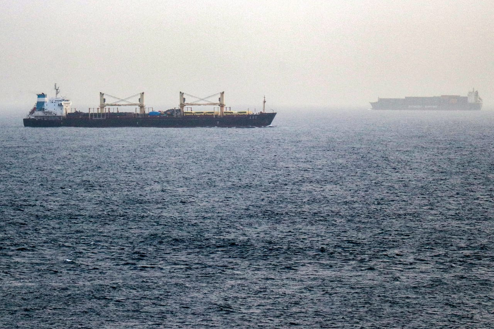

# Chokepoint diplomacy weaponizing maritime geography

- The recent fall of the Yemeni city of Mokha and its strategic port, followed immediately by the Houthi militia’s invasion of Mayun Island in the middle of the Bab Al-Mandab Strait, signal a permanent shift in global maritime security.

## Story

The recent fall of the Yemeni city of Mokha and its strategic port, followed immediately by the Houthi militia’s invasion of Mayun Island in the middle of the Bab Al-Mandab Strait, signal a permanent shift in global maritime security. This coordinated maritime encirclement, cementing its strategic weight across global shipping corridors, directly mirrors the Ottoman fleet’s siege of the Malacca Strait in 1569, which successfully strangled trade with the global empires of Spain, Genoa, Portugal and Venice.

Modern nonstate actors and regional powers have effectively weaponized these waterways, transforming once-free global passageways into tools for the total economic strangulation of distant capitals without ever marching on their borders.

History repeats itself with absolute clarity, confronting the international order with a raw reality that shatters its foundational credibility: maritime geography has permanently shifted from a safe commercial commons into a supreme weapon of political blackmail — a weapon whose asymmetric power completely surpasses conventional military arsenals and renders international maritime laws entirely powerless.

Geopolitical containment across the southern Red Sea now strikes directly at the core of global energy stability. Falling coastal territories along the Yemeni coast have triggered an immediate domino effect, destabilizing Saudi Arabia’s strategic East-West Pipeline network and forcing major state enterprises like Aramco to structurally reroute shipments away from European refineries. This calculated freeze of 3.1 million barrels per day of crude oil and vital derivatives presents a severe threat to Asian and Western energy security alike.

- Source: Arab News
- Related: [[Will Malacca Strait become the next maritime flashpoint]], [[Yemeni forces repel major Houthi assaults in Taiz, strike targets in]], [[Tanker damaged after attack in Hormuz maritime agency]]

Back to [[Opinion]].
