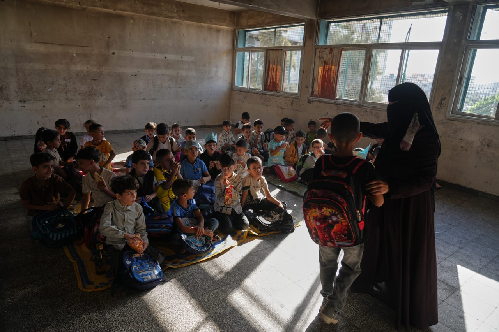

# Court overturns UK decisions blocking Gaza mothers, children from family

- LONDON: A UK immigration court has overturned government decisions preventing two Palestinian families in Gaza from joining their husbands and fathers in Britain, ruling that the Home Office acted unlawfully in applying its policy on biometric checks.

## Story

LONDON: A UK immigration court has overturned government decisions preventing two Palestinian families in Gaza from joining their husbands and fathers in Britain, ruling that the Home Office acted unlawfully in applying its policy on biometric checks.

The immigration court known as the upper tribunal found that the government had unlawfully applied its “unsafe journeys” policy to the two families, whose mothers and five children, aged 7 or younger, are seeking to reunite with their husbands and fathers who have been granted refugee status in the UK.

The families have been living in Gaza in tents amid the ongoing war, with the court hearing that they face severe shortages of food and clean water as well as exposure to rodents, mosquitoes and bed bugs, while also facing the threat of sniper fire, The Guardian reported on Sunday .

Judge Fiona Lindsley said the children’s welfare should have been given primary consideration when the Home Office made its decisions.

- Source: Arab News
- Related: [[Armed Israeli settlers harass independent journalist and activists]], [[Armed Israeli settler tries to break into Palestinian home]]

Back to [[World]].
