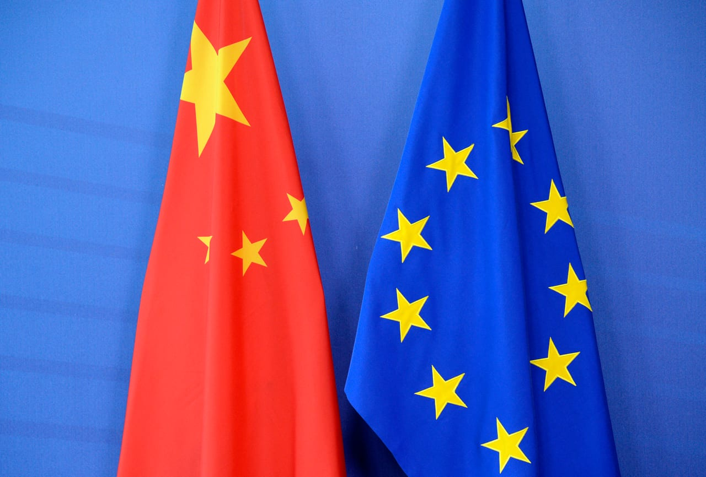

# EU weighs cost of open trade policy with China

- EU concerns about the bloc’s relationship, especially its trade deficit, with China are not new.
- However, a potential pivot point is approaching that may be the most important for bilateral relations since the 2008-09 global financial crisis or even Beijing’s 2001 accession to the World Trade Organization.
- In a diverse region of 27 member states, marshalling consensus across the EU is rarely easy.

## Story

EU concerns about the bloc’s relationship, especially its trade deficit, with China are not new. However, a potential pivot point is approaching that may be the most important for bilateral relations since the 2008-09 global financial crisis or even Beijing’s 2001 accession to the World Trade Organization.

In a diverse region of 27 member states, marshalling consensus across the EU is rarely easy. However, senior politicians in national capitals and Brussels are increasingly aware that its economy may face an existential challenge without stronger action. This is what European Commission President Ursula von der Leyen warns risks becoming a “new China shock.”

In 2025, China’s trade surplus with the EU hit €360.6 billion ($411 billion), larger than with the US. Strikingly, that total is almost exactly €1 billion a day, an increase of 15 percent from 2024. It is increasingly clear that the managed competition of recent years is not enough and that a tougher trade policy is necessary.

This appears to be the view of a growing number of senior European politicians, including French President Emmanuel Macron and German Chancellor Friedrich Merz. This is important not only because France and Germany are the EU’s largest economies but also because both have previously been among the strongest advocates of open European trade with China.

- Source: Arab News
- Related: [[Kingdom calls for global cooperation on child safety]], [[Chokepoint diplomacy weaponizing maritime geography]], [[Will Malacca Strait become the next maritime flashpoint]]

Back to [[Opinion]].
