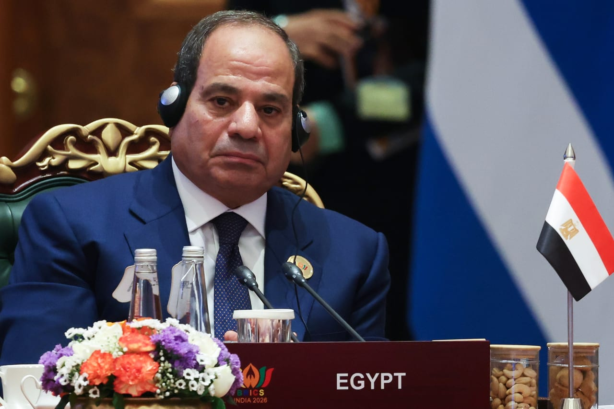

# Egypt’s El-Sisi urges ‘dialogue, not confrontation’ as African leaders

- CAIRO: Egyptian President Abdel Fattah El-Sisi on Sunday urged African leaders to pursue “dialogue, not confrontation” in addressing cross-border challenges, ahead of talks in Egypt involving Ethiopia’s neighbours as concerns grow that escalating violence could spill across borders.

## Story

CAIRO: Egyptian President Abdel Fattah El-Sisi on Sunday urged African leaders to pursue “dialogue, not confrontation” in addressing cross-border challenges, ahead of talks in Egypt involving Ethiopia’s neighbours as concerns grow that escalating violence could spill across borders.

Speaking at the African Union’s mid-year coordination summit in the Mediterranean city of El-Alamein, El-Sisi said cross-border challenges “require cooperation, not competition, and dialogue, not confrontation, including the management and use of natural resources and transboundary rivers in accordance with international law."

- Source: Arab News
- Related: [[Ethiopia controls Tigray capital as regional rivals meet in Egypt]]

Back to [[Middle East]].
