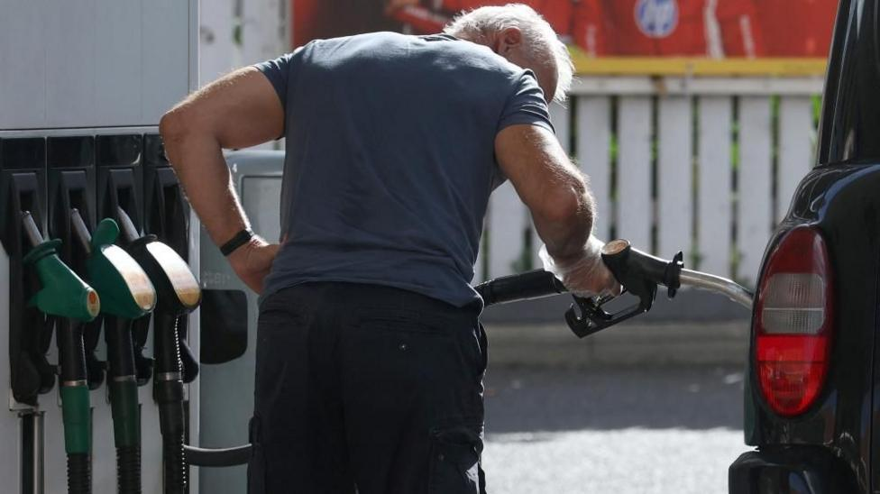

# G7 to release millions of barrels of oil and diesel after Trump threat

- The co-ordinated release is aimed at heading off further price spikes and avoiding a ban on US diesel exports.

- Source: BBC

Back to [[Business News]].
