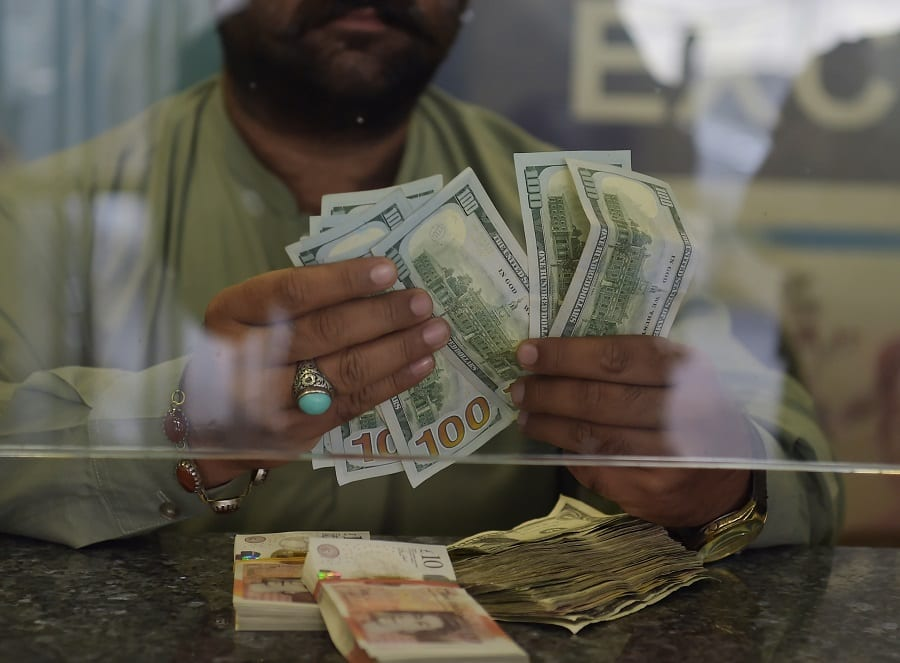

# GCC tops global remittance outflows at $161bn

- RIYADH: Gulf Cooperation Council countries recorded the highest value of outward workers’ remittances globally in 2025, with transfers reaching about $161 billion, official data showed.
- 6 percent from 2024, marking a second consecutive year of growth after remittance outflows declined in 2023, according to GCC-Stat data cited by the UAE’s state news agency, WAM.

## Story

RIYADH: Gulf Cooperation Council countries recorded the highest value of outward workers’ remittances globally in 2025, with transfers reaching about $161 billion, official data showed.&nbsp;

The figure rose 13.6 percent from 2024, marking a second consecutive year of growth after remittance outflows declined in 2023, according to GCC-Stat data cited by the UAE’s state news agency, WAM .&nbsp; &nbsp; The GCC’s remittance flows have increased alongside the region’s economic expansion and continued reliance on expatriate workers. The bloc’s population reached 63.3 million in 2025, while non-oil activities accounted for 70.6 percent&nbsp;of combined gross domestic product and grew 5.1 percent during the year.&nbsp; &nbsp; The increase comes as Gulf economies continue to attract expatriate labor to support infrastructure, services, industry and other non-oil sectors. The shift toward more diversified economies has also increased demand for workers across a broader range of industries.&nbsp;

The International Monetary Fund said economies with larger non-hydrocarbon sectors, including Bahrain, Saudi Arabia and the UAE, were better positioned to cushion the impact of recent disruptions, although weaker trade and business confidence have constrained activity.&nbsp;

“The data highlighted the exceptional global standing of the GCC countries when comparing their total outgoing remittances with the remittance values recorded in a number of major economies individually,” the WAM report stated.&nbsp;

- Source: Arab News
- Related: [[Oman’s business activity expands as wholesale, retail sector grows 5]], [[UAE, Syria central banks sign MoU to deepen financial cooperation]], [[Saudi tourism facilities expand 18 percent as hospitality supply grows]]

Back to [[Business]].
