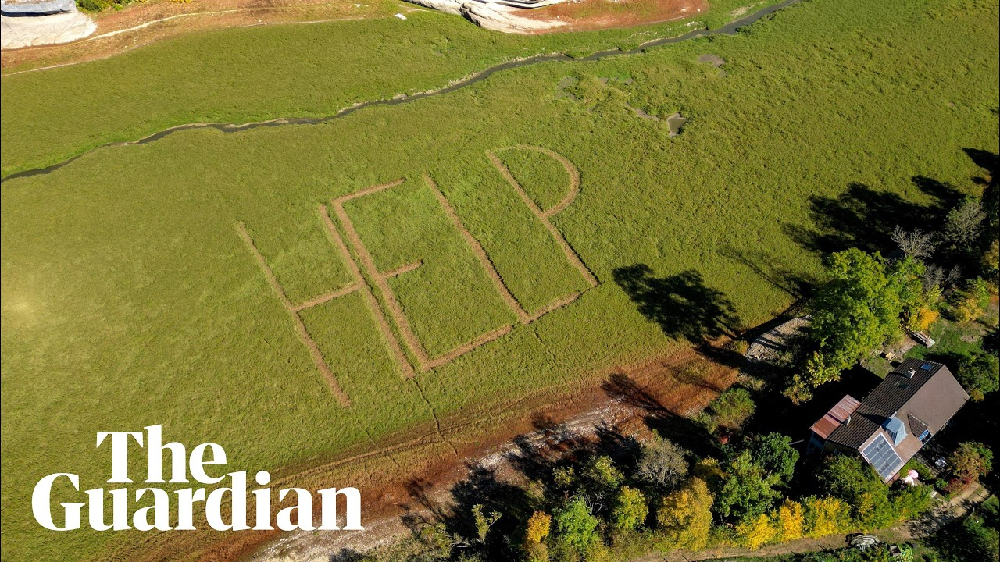

# Giant 'HELP' sign emerges on drought-stricken Swiss lakebed

[video](youtube:Dbx5Igb-gWY)

- Signs reading 'HELP' and 'SOS' have appeared on the dried lakebed of Lake Brenets in Switzerland.
- The appeal from an unknown author reflects growing alarm in a region where four months of exceptionally low rainfall has left the popular tourist destination almost completely without water.
- The drought has already surpassed the extreme dry spell of 2018, previously considered a once-in-a-century event, and is likely to surpass record 1906 levels if forecast rainfall fails to materialise.

- Source: Guardian

Back to [[Video News]].
