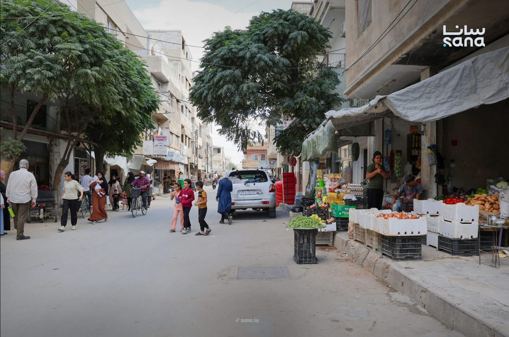

# Homs neighborhood sees commercial revival as residents return

- HOMS: Commercial activity in Homs’ Al-Bayada neighborhood is picking up as most residents return and an estimated 80 percent to 90 percent of shops reopen, helped by improvements in electricity, water and other basic services, residents and local officials said.
- Particularly in Al-Zeer Street, more shops are operating and more shoppers are present than a year ago, while commercial activities have become more diverse.
- Demand for shops and apartments has also increased.

## Story

HOMS: Commercial activity in&nbsp;Homs’ Al-Bayada neighborhood&nbsp;is picking up as most residents return and an estimated 80 percent to 90 percent of shops reopen, helped by improvements in electricity, water and other basic services, residents and local officials said.

Particularly in Al-Zeer Street, more shops are operating and more shoppers are present than a year ago, while&nbsp;commercial activities&nbsp;have become more diverse. Demand for shops and apartments has also increased.

Real estate agent Maher Kanaan said demand for buying and renting shops and apartments had risen over the past year as residents returned and several buildings were rehabilitated, boosting purchasing, consumption and commercial activity.

Mohammad Al-Qabbani,&nbsp;who runs a shop selling spices and food products, said commercial activity had been limited a year ago because of the&nbsp;smaller population.&nbsp;It has since improved as residents returned and more shops and apartments became occupied.

- Source: Arab News
- Related: [[Oman’s business activity expands as wholesale, retail sector grows 5]], [[Saudi tourism facilities expand 18 percent as hospitality supply grows]], [[Yemeni forces repel major Houthi assaults in Taiz, strike targets in]]

Back to [[Middle East]].
