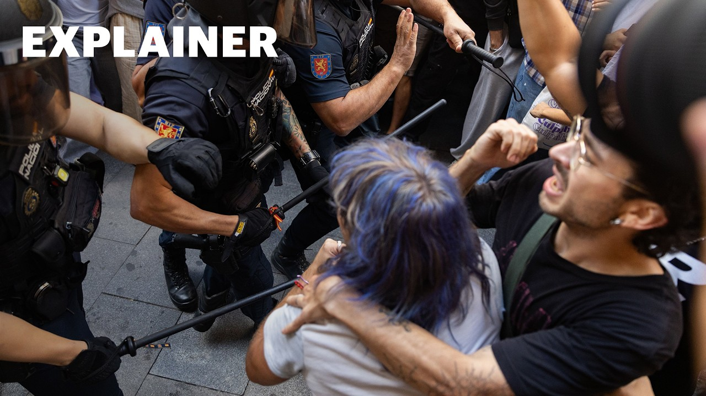

# How an 87-year-old Spanish woman became the face of the fight for

[video](youtube:4J6160hChbk)

- María del Carmen Abascal, 87, was evicted from her home, on a stretcher, after being given 30 minutes to gather her belongings.

- Source: Guardian

Back to [[Video News]].
