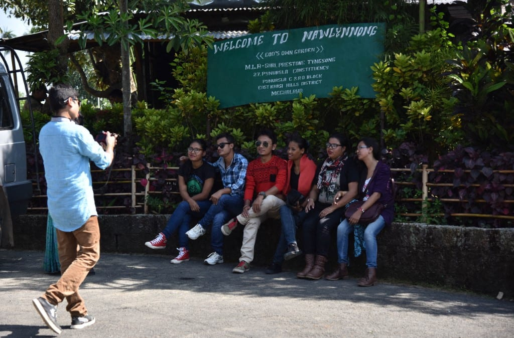

# India’s ‘cleanest village’ bars visitors on Sundays to regain peace

- NEW DELHI: When they lock their gates to the outside world every Sunday, residents of Mawlynnong get to enjoy a mandatory day of rest from overwhelming crowds, remembering how life used to be before they shot to fame as India’s cleanest village.
- Located in India’s mountainous state of Meghalaya, near the border with Bangladesh, Mawlynnong boasts lush green trees, flower-decked streets, and neatly maintained houses.

## Story

NEW DELHI: When they lock their gates to the outside world every Sunday, residents of Mawlynnong get to enjoy a mandatory day of rest from overwhelming crowds, remembering how life used to be before they shot to fame as India’s cleanest village.

Located in India’s mountainous state of Meghalaya, near the border with Bangladesh, Mawlynnong boasts lush green trees, flower-decked streets, and neatly maintained houses. In every corner, there is a cone-shaped bamboo dustbin, and no trace of litter anywhere in the area. The air is clean, free from construction dust and vehicle exhaust.

Visitors need to park their cars or buses in a designated area outside and walk down to the village gate, where they are charged about one dollar to enter.

The popularity started in the early 2000s, after local media showed how clean the remote village was — a feat in a country where sanitation remains a challenge in rural areas. Soon, the Discover India magazine arrived too, and made a documentary in which it named Mawlynnong “the cleanest village in Asia” — a declaration that brought sudden welfare to the region and transformed its economy.

- Source: Arab News
- Related: [[Israeli forces fire tear gas at Palestinians after settlers reportedly]], [[Al-Alimi announces launch of military operations against Houthi militias]], [[The world now has two Myanmars]]

Back to [[World]].
