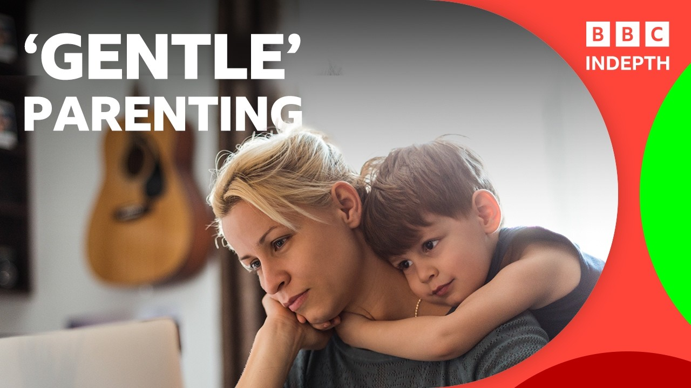

# Inside the debate over ‘gentle’ parenting and boundaries BBC News

[video](youtube:P0MbDizmwRU)

- Government research suggests that around two thirds of parents with young children feel overwhelmed by the amount of parenting information available and struggle with conflicting advice, with many turning to social media for support.
- Faced with an array of parenting philosophies, or "brands" to choose from, is all of this advice helping parents or making them more anxious?
- And is there really a best way to parent?

- Source: BBC
- Related: [[Burnham’s plans for social care and its workers are admirable but]], [[Modric ‘ashamed’ after 7-0 defeat by England; Republic of Ireland v]]

Back to [[Video News]].
