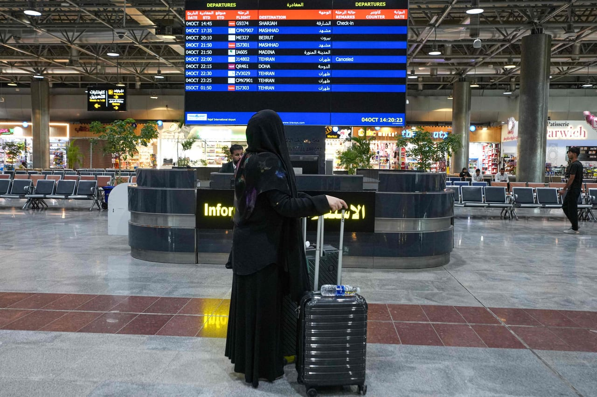

# Iran airlines resume flights to Najaf after US exemption

- Iranian airlines have resumed flights to Najaf, Iraq after the US granted an exemption allowing Iranian airlines to operate in the city.
- The first flight was conducted by Caspian Airlines.

## Story

NAJAF: Iranian airlines resumed flights to Iraq’s Najaf on Sunday after the United States granted Baghdad an exemption allowing sanctioned Iranian carriers to operate to the city holy to Shia Muslims, an AFP correspondent said.

Najaf airport official Hussein Muhanna told AFP that “flights between Iraq and the Islamic Republic of Iran have resumed via Najaf International Airport.”

The first flight was operated by Caspian Airlines with AFP’s correspondent at the airport reporting seeing the plane land at 5:15 pm (1415 GMT).

On Friday, the Iraqi government said it had secured an agreement with the US allowing Iranian airlines, except Mahan Air, to operate 40 daily flights to and from Najaf, which is home to one of the most revered shrines in Shia Islam.

- Source: Arab News

Back to [[Middle East]].
