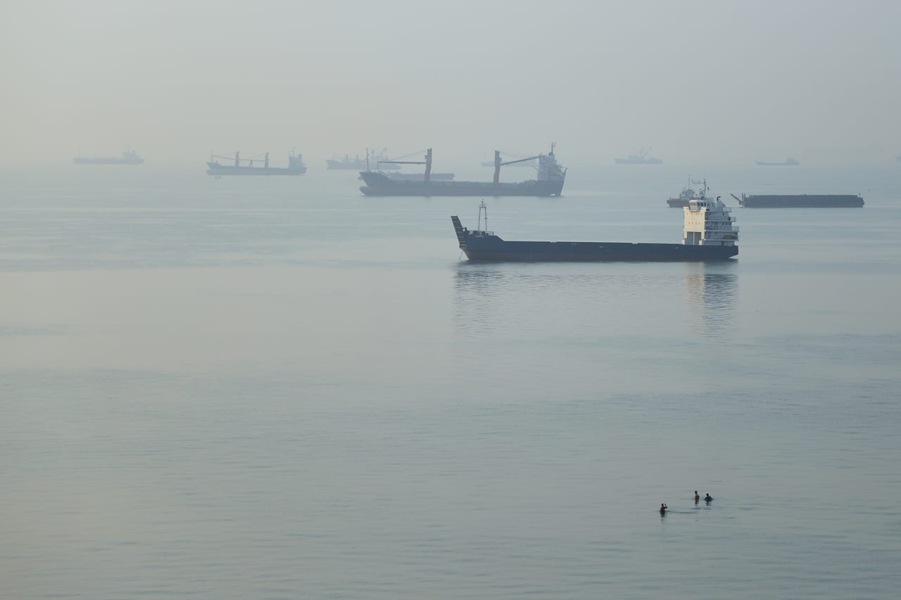

# Iran says Strait of Hormuz will not reopen until conditions are met

- Iran’s Parliament Speaker Qalibaf announced that the Strait of Hormuz will remain closed until Iran’s conditions are satisfied, stating that the US can no longer delay the process.

## Story

DUBAI: The Strait of Hormuz will not reopen until seven Iranian conditions set out ​in a June interim agreement with the US are met, Nournews reported Iran’s parliament speaker Mohammad Baqer Qalibaf as saying on Sunday, a few days after Tehran received Washington’s reply to its diplomatic proposal.

“The Americans, who say something different in the media, have ‌recently put ‌forward proposals through ​a ‌mediator. ⁠But they must ​understand that ⁠the period of dragging out the process and dictating one-sided demands is over,” Qalibaf was quoted as saying.

“The position of the Islamic Republic of Iran is completely clear and firm, and the Strait of Hormuz ⁠will not be opened until our ‌seven conditions, based ‌on the Islamabad Memorandum of Understanding, ​are met.”

Iranian Foreign ‌Minister Abbas Araghchi said separately on Sunday ‌that a plan put forward by Tehran to resolve its dispute with Washington could lead to the Strait of Hormuz reopening within seven days ‌if accepted.

- Source: Arab News
- Related: [[Tanker damaged after attack in Hormuz maritime agency]], [[Will Malacca Strait become the next maritime flashpoint]]

Back to [[Middle East]].
