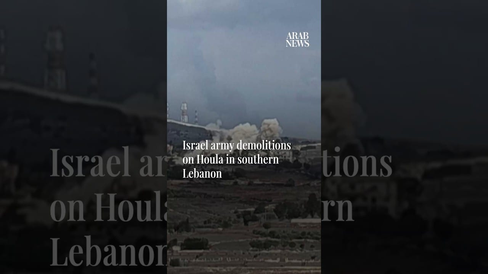

# Israel carries out controlled explosions on Houla in southern Lebanon

[video](youtube:IFtoAm8qlOA)

- The Israeli army carried out demolitions in the southern Lebanese village of Houla, roughly 2km from the Israeli border.
- Lebanese authorities accuse Israel of systematically destroying villages in the south, including homes, schools, places of worship and water and electricity infrastructure.

- Source: Arab News
- Related: [[Israeli forces blow up school, burn homes in southern Lebanon, Lebanese]], [[8 Israeli soldiers wounded in southern Lebanon ‘vehicle collision’]], [[Israeli settlers attack Palestinian village south of Nablus]]

Back to [[Video]].
