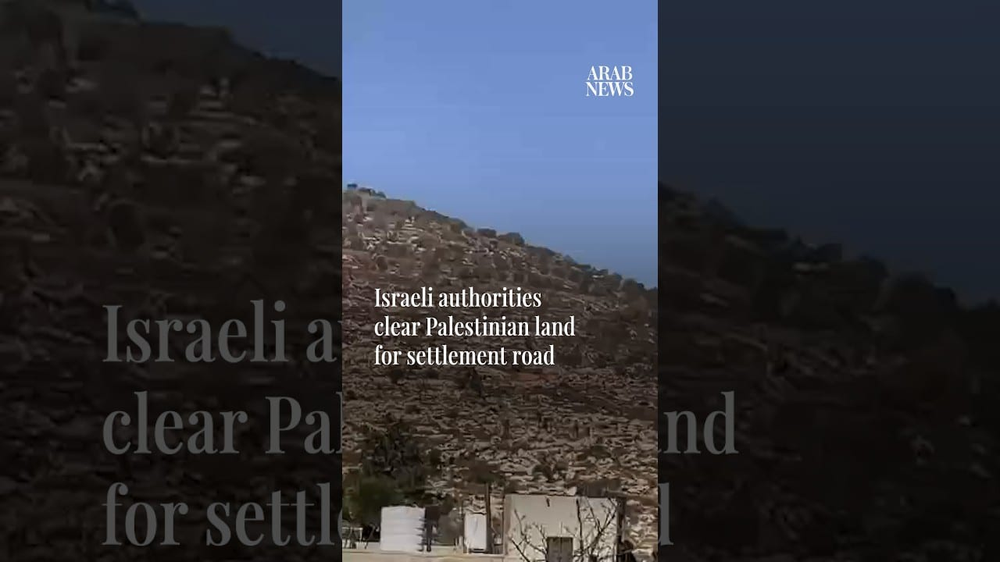

# Israeli authorities clear Palestinian land for settlement road

[video](youtube:gaTS22Ip-UI)

- Israeli authorities’ machinery clears Palestinian agricultural land east of the village of Al-Mughayyir, northeast of Ramallah in the occupied West Bank, in preparation for a new settlement road.

- Source: Arab News
- Related: [[Israeli forces fire tear gas at Palestinians after settlers reportedly]], [[Armed Israeli settlers harass independent journalist and activists]], [[Armed Israeli settler tries to break into Palestinian home]]

Back to [[Video]].
