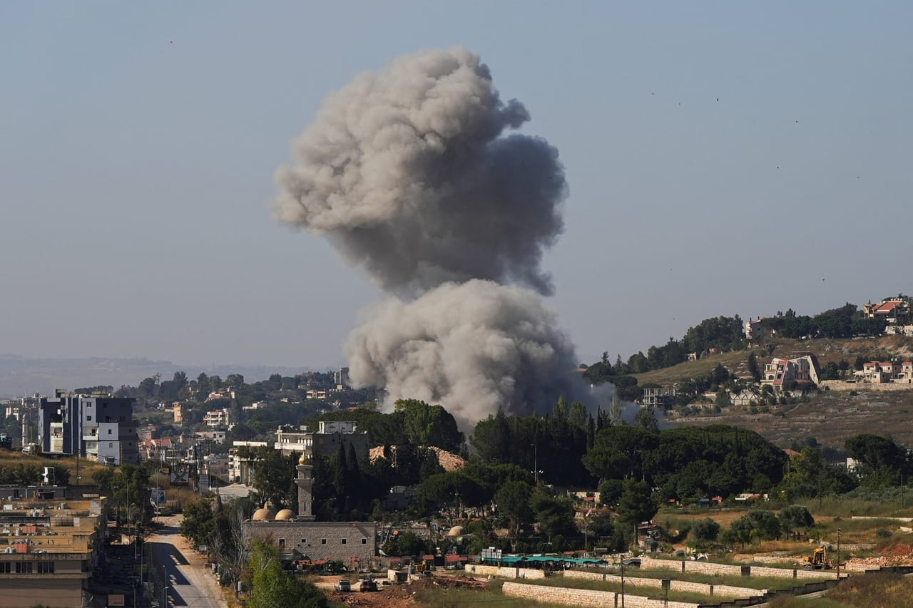

# Israeli forces blow up school, burn homes in southern Lebanon, Lebanese

- LONDON: Israeli forces bombed a private school, set fire to homes and carried out airstrikes and artillery attacks across southern Lebanon on Saturday, Lebanese media reported.
- In the border town of Houla in the Marjayoun district, Israeli troops planted explosives inside a private school and detonated them, destroying the building, the agency said.
- Forces also burned homes in the town, according to Lebanon’s state-run National News Agency.

## Story

LONDON: Israeli forces bombed a private school, set fire to homes and carried out airstrikes and artillery attacks across southern Lebanon on Saturday, Lebanese media reported.

In the border town of Houla in the Marjayoun district, Israeli troops planted explosives inside a private school and detonated them, destroying the building, the agency said. Forces also burned homes in the town, according to Lebanon’s state-run National News Agency.

The reported destruction came amid a broader escalation of Israeli military activity across southern Lebanon.

Israeli artillery shelled Khiam and repeatedly struck Tallouseh and Bani Hayyan, while Israeli warplanes carried out two airstrikes on Bani Hayyan, NNA said.

- Source: Arab News
- Related: [[8 Israeli soldiers wounded in southern Lebanon ‘vehicle collision’]], [[Israel carries out controlled explosions on Houla in southern Lebanon]], [[Israeli forces fire tear gas at Palestinians after settlers reportedly]]

Back to [[Middle East]].
