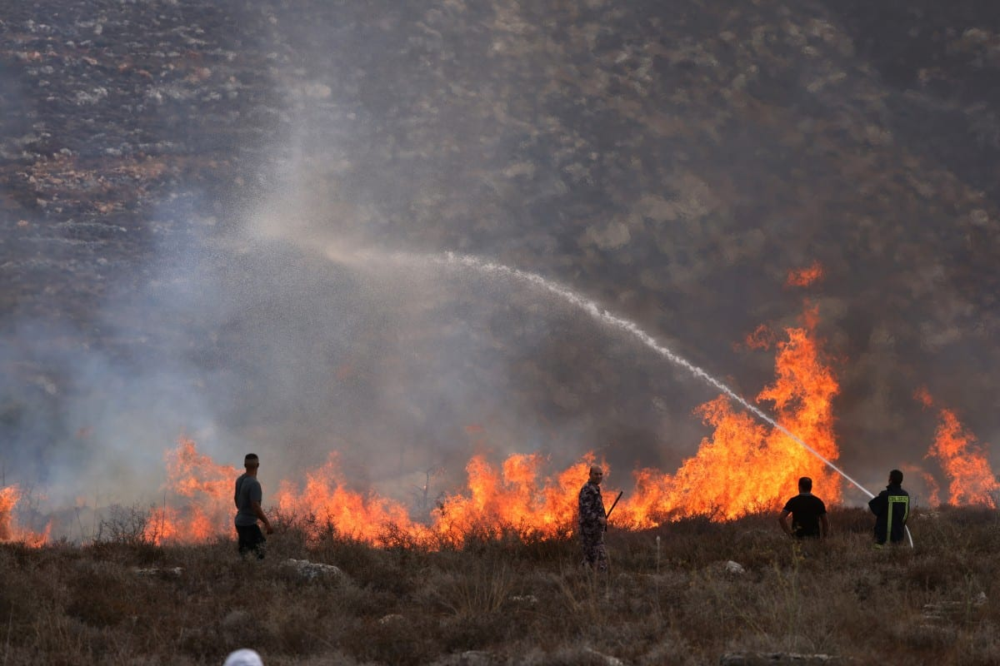

# Israeli forces fire tear gas at Palestinians after settlers reportedly

- LONDON: Several Palestinians in the occupied West Bank suffered tear gas inhalation on Sunday after Israeli forces intervened during a confrontation between residents and Israeli settlers who entered farmland near the village of Al-Mughayyir, east of Ramallah, local sources said.
- The confrontation began when settlers entered the village’s eastern plain and released livestock onto Palestinian-owned land, the sources told the official Palestinian news agency WAFA.

## Story

LONDON: Several Palestinians in the occupied West Bank suffered tear gas inhalation on Sunday after Israeli forces intervened during a confrontation between residents and Israeli settlers who entered farmland near the village of Al-Mughayyir, east of Ramallah, local sources said.

The confrontation began when settlers entered the village’s eastern plain and released livestock onto Palestinian-owned land, the sources told the official Palestinian news agency WAFA.

Residents confronted the settlers before Israeli forces arrived and fired tear gas, leaving several people needing treatment for suffocation, the sources said.

Israeli forces later entered Al-Mughayyir and detained several students while they were traveling to school, according to local sources. Earlier in the day, soldiers raided several homes in the village, though no arrests were reported.

- Source: Arab News
- Related: [[Israeli authorities clear Palestinian land for settlement road]], [[Armed Israeli settlers harass independent journalist and activists]], [[Israeli forces prevent Palestinians from reaching olive groves]]

Back to [[Middle East]].
