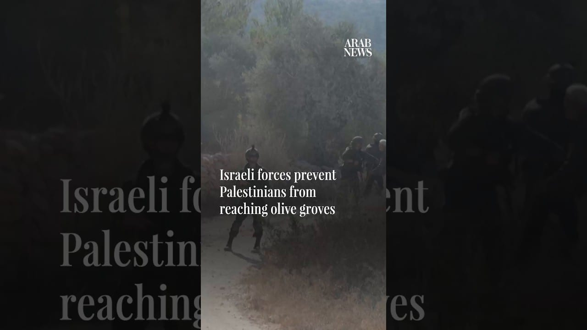

# Israeli forces prevent Palestinians from reaching olive groves

[video](youtube:qsyaBDNf88c)

- Israeli settlers and soldiers chased away Palestinians and activists as they attempted to harvest olives in the West Bank village of Beita, near Nablus on Saturday (October 3), on the second day in row

- Source: Arab News
- Related: [[Israeli forces fire tear gas at Palestinians after settlers reportedly]], [[Armed Israeli settlers harass independent journalist and activists]], [[8 Israeli soldiers wounded in southern Lebanon ‘vehicle collision’]]

Back to [[Video]].
