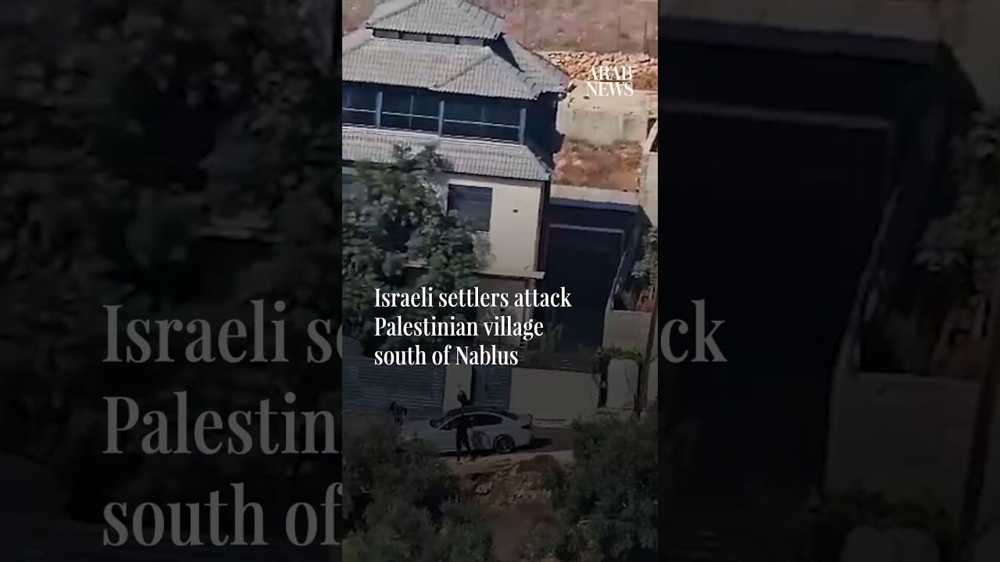

# Israeli settlers attack Palestinian village south of Nablus

[video](youtube:m5Mjx1m5oZ0)

- Dozens of Israeli settlers, backed by the Israeli army, are attacking the village of Osarin, south of Nablus, in an attempt to force Palestinian residents from their homes and empty the village.

- Source: Arab News
- Related: [[Israeli forces fire tear gas at Palestinians after settlers reportedly]], [[Israel carries out controlled explosions on Houla in southern Lebanon]], [[Armed Israeli settlers harass independent journalist and activists]]

Back to [[Video]].
