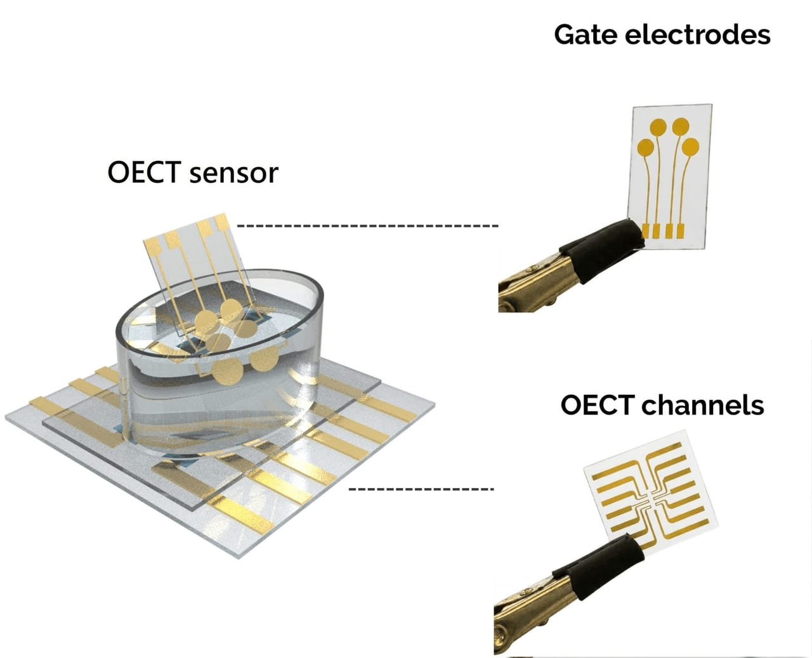

# KAUST develops sensor for potential early detection of Parkinson’s

- JEDDAH: Researchers at King Abdullah University of Science and Technology have developed an electronic sensor that can detect molecular signatures associated with Parkinson’s disease in blood, an advance that could eventually help identify the disease before characteristic symptoms emerge.

## Story

JEDDAH: Researchers at King Abdullah University of Science and Technology have developed an electronic sensor that can detect molecular signatures associated with Parkinson’s disease in blood, an advance that could eventually help identify the disease before characteristic symptoms emerge.

The technology, developed by KAUST researchers in collaboration with the University of Oxford, simultaneously detects three forms of alpha-synuclein, a protein closely associated with Parkinson’s disease, according to a study published in Science Advances.

In an initial blinded evaluation involving 59 participants from the Oxford Discovery cohort, the platform achieved 90.9 percent accuracy in distinguishing disease-associated profiles from healthy controls. The study included people with Parkinson’s disease, healthy controls and individuals with isolated REM sleep behavior disorder, or iRBD, a condition associated with an increased risk of developing Parkinson’s disease or related neurological disorders.

Speaking to Arab News, Sahika Inal, associate professor of bioengineering at KAUST, said the next phase of research will focus on testing the sensor in larger patient cohorts. “That requires us also to make more of the same sensors of the same quality with industrial precision,” she said.

- Source: Arab News
- Related: [[Saudi institutes advance in global education rankings]]

Back to [[Saudi Arabia]].
