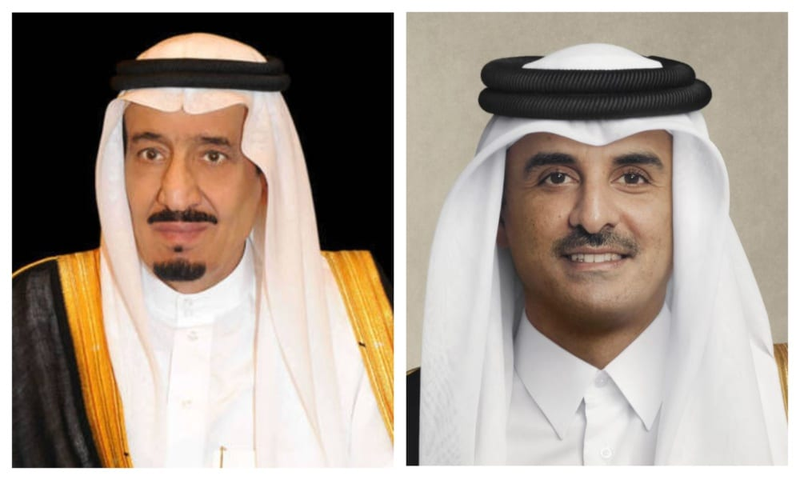

# King Salman invites Qatar emir to GCC-EU Summit to be held in October

- RIYADH: King Salman on Sunday invited Qatar’s Sheikh Tamim bin Hamad Al-Thani to participate in the second GCC-EU Summit which the Kingdom is hosting on Oct.
- The message was delivered by the Saudi ambassador to Qatar Prince Saad bin Mansour bin Saad during a meeting with the emir at his office in Lusail Palace.
- During the meeting, relations between the two countries and ways to further develop and enhance them were discussed.

## Story

RIYADH: King Salman on Sunday invited Qatar’s Sheikh Tamim bin Hamad Al-Thani to participate in the second GCC-EU Summit which the Kingdom is hosting on Oct. 24. The message was delivered by the Saudi ambassador to Qatar Prince Saad bin Mansour bin Saad during a meeting with the emir at his office in Lusail Palace. During the meeting, relations between the two countries and ways to further develop and enhance them were discussed. Prince Saad conveyed the greetings of King Salman to the emir of Qatar, who also sent his greetings to the king. The first GCC-EU Summit took place in Brussels in October 2024. The President of the European Council Antonio Costa said in September that the partnership between the blocs is anchored in “political dialogue, coordination and engagement, with the aim of promoting global and regional peace, security, and prosperity for the benefit of the people of our regions and beyond.” “Our past, present and future are interconnected. The time has come to deepen the EU-GCC partnership,” he said.

- Source: Arab News
- Related: [[Kingdom calls for global cooperation on child safety]], [[Two Mongolian saker falcons fetch $147,000 at Riyadh hunting exhibition]], [[OPEC+ agrees to keep November oil output targets steady]]

Back to [[Saudi Arabia]].
