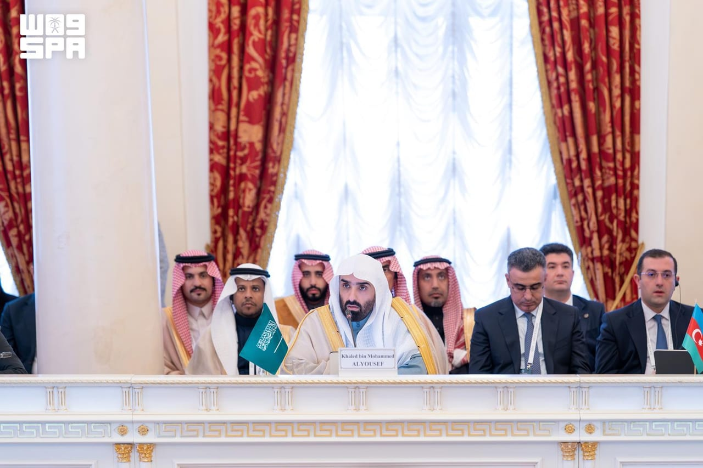

# Kingdom calls for global cooperation on child safety

- KAZAN: Saudi Arabia’s Attorney General and Chairman of the Public Prosecution Council Khalid Al-Yousef represented the Kingdom at the 24th Meeting of the Prosecutors General of the Shanghai Cooperation Organization’s Member States, in Kazan, Russia.
- The meeting, with representatives from 20 countries, discussed ways to enhance international cooperation to protect minors, combat illegal content and cybercrimes, and exchange expertise and best practices.

## Story

KAZAN: Saudi Arabia’s Attorney General and Chairman of the Public Prosecution Council Khalid Al-Yousef represented the Kingdom at the 24th Meeting of the Prosecutors General of the Shanghai Cooperation Organization’s Member States, in Kazan, Russia.

The meeting, with representatives from 20 countries, discussed ways to enhance international cooperation to protect minors, combat illegal content and cybercrimes, and exchange expertise and best practices.

Al-Yousef highlighted Saudi Arabia’s focus on building society and protecting families and youth under the Kingdom’s Vision 2030 reform plan.

He reviewed the Public Prosecution’s efforts to protect minors from cybercrimes through specialized family affairs prosecutions, working with competent authorities to protect children’s rights and combat harmful digital content.

- Source: Arab News
- Related: [[King Salman invites Qatar emir to GCC-EU Summit to be held in October]], [[Saudi institutes advance in global education rankings]], [[GCC tops global remittance outflows at $161bn]]

Back to [[Saudi Arabia]].
