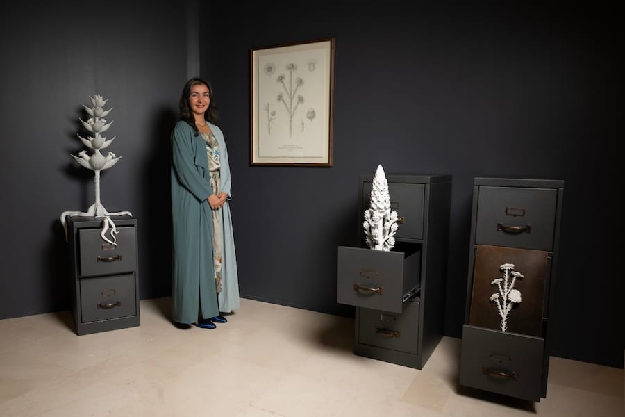

# Kuwaiti artist Aseel Al-Yaqoub wins Ithra Art Prize 2026

- DUBAI: Kuwaiti artist Aseel Al-Yaqoub has been named the winner of the seventh Ithra Art Prize for her work “Flora Incognita” (2026).
- Al-Yaqoub was announced as the recipient during a ceremony at the King Abdulaziz Center for World Culture, or Ithra, in Dhahran, Saudi Arabia, on Oct.
- She receives a SR376,000 ($100,000) grant to support her practice, while her winning work will become part of Ithra’s permanent collection.

## Story

DUBAI: Kuwaiti artist Aseel Al-Yaqoub has been named the winner of the seventh Ithra Art Prize for her work “Flora Incognita” (2026).

Al-Yaqoub was announced as the recipient during a ceremony at the King Abdulaziz Center for World Culture, or Ithra, in Dhahran, Saudi Arabia, on Oct. 1. She receives a SR376,000 ($100,000) grant to support her practice, while her winning work will become part of Ithra’s permanent collection.

“Flora Incognita” takes the form of a botanical herbarium featuring hybrid desert plants. Through 3D-printed sculptures, steel cabinets and graphite drawings, Al-Yaqoub examines the history of botanical classification in the Gulf and how systems of naming and categorization have shaped ideas of knowledge, identity and place.

The work is part of an exhibition featuring the five finalists for this year’s prize, which aims to support contemporary artists from across the Arab world. The exhibition brings together practices spanning installation, painting, textile and conceptual art.

- Source: Arab News
- Related: [[King Salman invites Qatar emir to GCC-EU Summit to be held in October]], [[Saudi institutes advance in global education rankings]], [[Saudi Arabia opens October ‘Sah’ sukuk with 5 percent annual return]]

Back to [[Lifestyle]].
