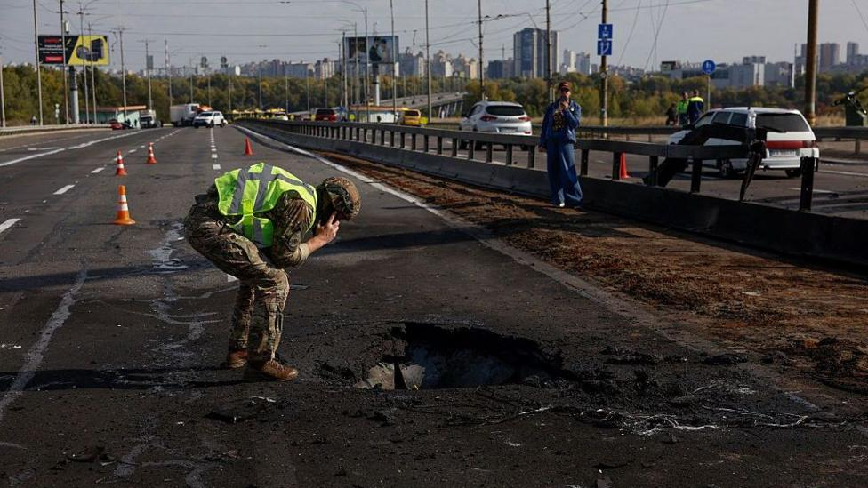

# Kyiv bridge hit in further Russian drone attack as German chancellor

- Footage shows a drone hitting the Pivnichyi (Northern) Bridge as vehicles move across it, creating a large fireball.

- Source: BBC
- Related: [[What can German Chancellor Friedrich Merz offer Ukraine DW News]]

Back to [[World News]].
