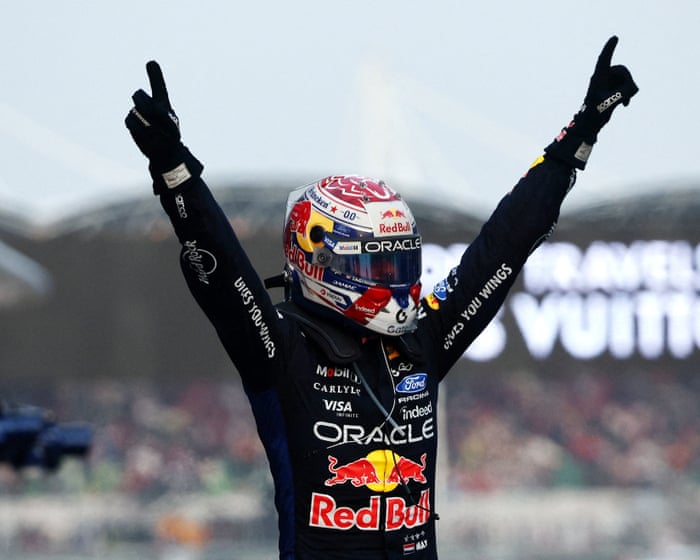

# Max Verstappen wins chaotic F1 Bahrain GP in Malaysia after rain causes

- First win of season for Dutchman after long rain delay Heartbreak for Russell as power units struggle in weather Max Verstappen won a chaotic Bahrain Grand Prix in Malaysia with a dominant drive for Red Bull, his team’s first win of the season, beating the Mercedes of Kimi Antonelli into second.
- The Italian’s teammate and title rival George Russell was forced to retire with five laps to go leaving the British driver’s title hopes shattered and Antonelli within touching distance of the championship.
- Lewis Hamilton was third for Ferrari, making a remarkable comeback after a torrid afternoon, starting on the slick rubber tyres in the wet which dropped him as far back as 17th before reviving with a superb drive, including a late pass on Isack Hadjar who finished fifth.

## Story

Max Verstappen won a chaotic Bahrain Grand Prix in Malaysia with a dominant drive for Red Bull, his team’s first win of the season, beating the Mercedes of Kimi Antonelli into second. The Italian’s teammate and title rival George Russell was forced to retire with five laps to go leaving the British driver’s title hopes shattered and Antonelli within touching distance of the championship.

Lewis Hamilton was third for Ferrari, making a remarkable comeback after a torrid afternoon, starting on the slick rubber tyres in the wet which dropped him as far back as 17th before reviving with a superb drive, including a late pass on Isack Hadjar who finished fifth. Ferrari’s Charles Leclerc was fourth after a race marked by farcical scenes before it was even underway. This season’s engine formula was found sorely wanting the first time it was tested in wet conditions.

For Antonelli, while Mercedes were no match for Verstappen and Red Bull , he did the required in leading his teammate for most of the race until Russell, who was in third place behind the Italian, had a power unit problem and had to pull off track. Heartbreak for Russell, who suffered an engine problem at the same track where Hamilton endured the similar failure in 2016 which all but cost him the title. Russell’s chances are surely now all but gone. Antonelli has an 84-point lead with seven meetings remaining.

The victory for Verstappen was as dominant as some of his best drives. Having passed Antonelli for the lead in the early stages he was untouchable out front to take the flag nine years after he won in Malaysia in 2017, the last time the circuit held a meeting, for his first win since the Abu Dhabi GP last year.

- Source: Guardian
- Related: [[Verstappen wins in Malaysia after long delays as Russell retires]], [[Recent lobbyist for Palantir had key role in helping Andy Burnham become]], [[UK car industry faces ‘difficult trade-off’ between Chinese and EU]]

Back to [[Sport News]].
