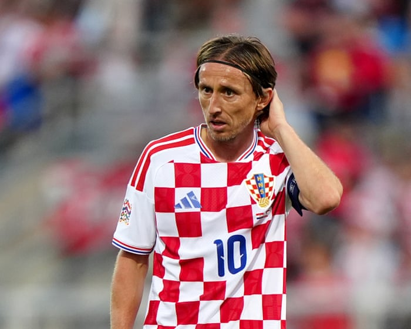

# Modric ‘ashamed’ after 7-0 defeat by England; Republic of Ireland v

- Latest news before Nations League fixtures Share your thoughts with us via email Harry Kane, now on 89 international goals from 124 games , says the Croatia performance has to be the blueprint for how England play.
- “Even when we were 1-0 up, we went for two, went for three, went for four, and that’s got to be our mentality.
- When you have a certain style of playing, you can’t just pick and choose when you want to do it.

- Source: Guardian
- Related: [[‘The violence is off the scale’ staff and passengers at risk as assaults]], [[UK car industry faces ‘difficult trade-off’ between Chinese and EU]], [[Burnham’s plans for social care and its workers are admirable but]]

Back to [[Sport News]].
