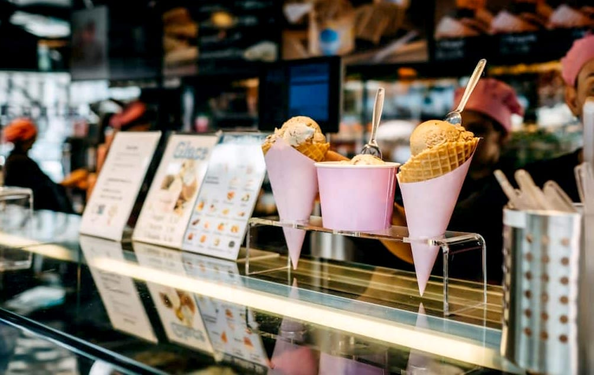

# New food safety rules for ice cream shops in Kingdom

- RIYADH: The Ministry of Municipalities and Housing has updated regulations governing ice cream shops to regulate operations, establish food safety requirements, clarify standards for investors and improve service quality.
- The updated regulations cover food safety from product receipt through storage, preparation and serving, including temperature control, allergen disclosure, and hygiene and sterilization procedures.

## Story

RIYADH: The Ministry of Municipalities and Housing has updated regulations governing ice cream shops to regulate operations, establish food safety requirements, clarify standards for investors and improve service quality.

The updated regulations cover food safety from product receipt through storage, preparation and serving, including temperature control, allergen disclosure, and hygiene and sterilization procedures.

They also require personnel to obtain health certificates, maintain personal hygiene, wear protective clothing and follow food safety practices. Establishments must also provide electronic payment systems and use standardized QR codes.

The ministry said that the updated regulations clarified investors’ and business owners’ obligations during establishment and operation, supporting business development while prioritizing customer safety and service quality.

- Source: Arab News
- Related: [[Saudi Arabia charts a resilient fiscal course for 2027]], [[Saudi project clears 1,256 mines in Yemen]], [[Bahrain tops Arab nations at Asian Games with 22 medals]]

Back to [[Saudi Arabia]].
