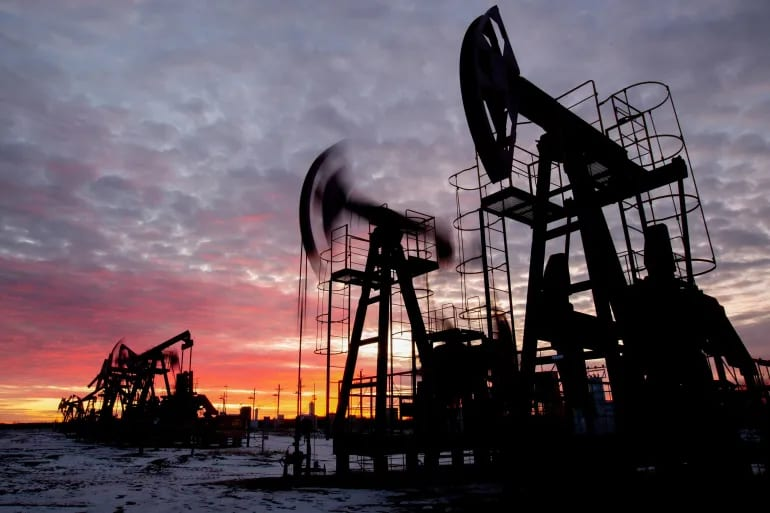

# OPEC+ agrees to keep November oil output targets steady

- RIYADH: The OPEC+ Joint Ministerial Monitoring Committee agreed to keep oil production targets steady for November at a meeting on Sunday.
- At its 68th meeting, held via videoconference, the committee reviewed current conditions in the oil market and reaffirmed the central role of the Declaration of Cooperation in supporting global energy market stability.

## Story

RIYADH: The OPEC+ Joint Ministerial Monitoring Committee agreed to keep oil production targets steady for November at a meeting on Sunday.

At its 68th meeting, held via videoconference, the committee reviewed current conditions in the oil market and reaffirmed the central role of the Declaration of Cooperation in supporting global energy market stability.

The committee stressed the importance of protecting international maritime shipping routes to ensure the continuous and uninterrupted flow of energy supplies. It also expressed concern over attacks targeting energy infrastructure, noting that restoring damaged facilities to full operating capacity is costly and time-consuming and could affect overall supply availability.

“Any actions that undermine the security of energy supplies,” whether by targeting infrastructure or disrupting international maritime routes, could increase market volatility and weaken collective efforts under the Declaration of Cooperation, the committee said.

- Source: Arab News
- Related: [[King Salman invites Qatar emir to GCC-EU Summit to be held in October]], [[Kingdom calls for global cooperation on child safety]], [[Saudi institutes advance in global education rankings]]

Back to [[Business]].
