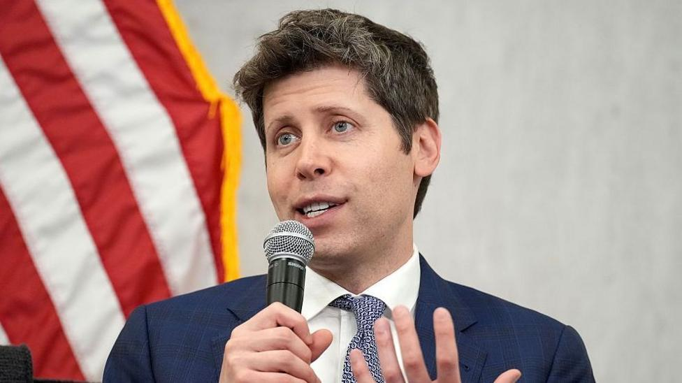

# OpenAI fires workers for 'mishandling sensitive information'

- The former employees were investigated for sharing data with an outside AI evaluation group.

- Source: BBC

Back to [[Technology News]].
