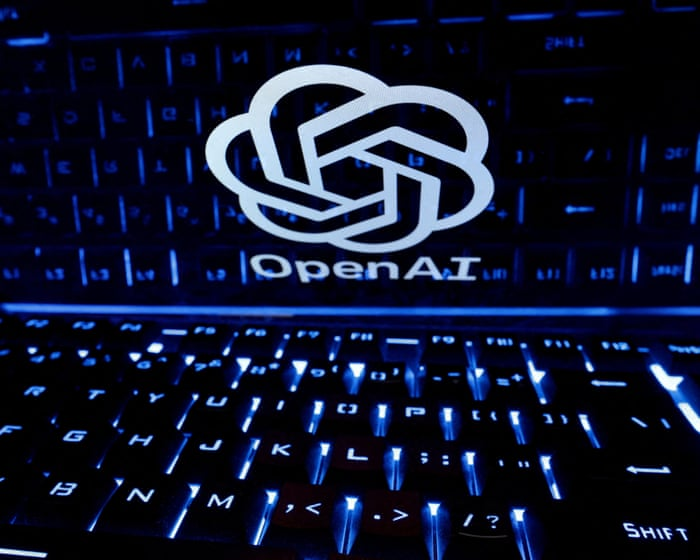

# OpenAI safety leader quits, warning AI company’s culture is ‘broken’

- David Robinson joins other insiders in urging industry to take more care over rapidly developing technology A safety leader at OpenAI has quit the company, warning that its culture was broken and that AI firms were not “being nearly careful enough” about developing the technology.
- David Robinson, who led the writing of safety reports that accompanied the ChatGPT developer’s product releases, explained his resignation in an essay headlined: “I quit OpenAI because its culture is broken.

## Story

David Robinson joins other insiders in urging industry to take more care over rapidly developing technology

A safety leader at OpenAI has quit the company, warning that its culture was broken and that AI firms were not “being nearly careful enough” about developing the technology.

David Robinson, who led the writing of safety reports that accompanied the ChatGPT developer’s product releases, explained his resignation in an essay headlined: “I quit OpenAI because its culture is broken.”

Robinson wrote that a cultural overhaul was needed at cutting-edge AI firms and incidents such as a “swarm” of OpenAI agents – AI programmes operating autonomously without human oversight – attacking the AI startup Hugging Face were “typical of the industry, given the speed and flexibility with which people operate”.

- Source: Guardian
- Related: [[Recent lobbyist for Palantir had key role in helping Andy Burnham become]], [[UK car industry faces ‘difficult trade-off’ between Chinese and EU]], [[Burnham’s plans for social care and its workers are admirable but]]

Back to [[Technology News]].
