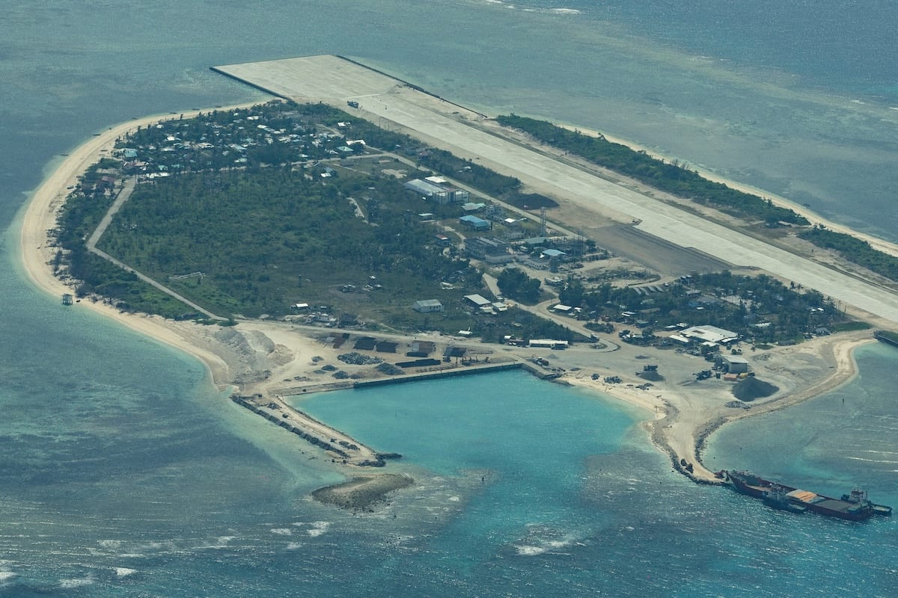

# Philippines accuses China of harassing patrols in disputed waters

- The Philippines has charged China with harassment in the South China Sea, involving a Chinese fighter jet and a Filipino military aircraft.
- The incident took place near Scarborough Shoal during a routine patrol.

## Story

MANILA: The Philippines accused China’s military and coast guard on Sunday of harassing Filipino government aircraft and boats in two areas of the disputed South China Sea.

A J-16 fighter interfered with a Filipino Cessna 208 turboprop that was conducting a “routine military patrol” near Scarborough Shoal on Saturday, a Philippine armed forces statement said.

“The J-16 repeatedly approached and maneuvered in close proximity to the Philippine aircraft, including maneuvering ahead of and around it and positioning itself within the Philippine aircraft’s wake,” it said.

While the Filipino aircraft completed its mission safely, the Filipino military called the incident “part of a recurring pattern of unsafe and coercive behavior against Philippine government vessels and aircraft conducting lawful operations”.

- Source: Arab News
- Related: [[8 Israeli soldiers wounded in southern Lebanon ‘vehicle collision’]]

Back to [[World]].
