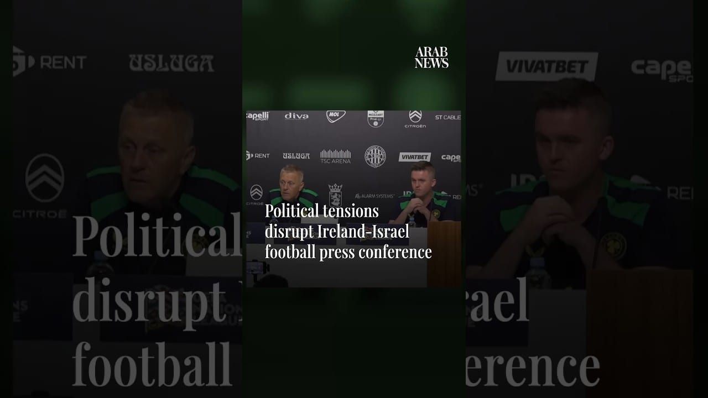

# Political tensions disrupt Ireland-Israel football press conference

[video](youtube:gtiOTDHFh4k)

- Arguments between Israeli journalists and Irish media officials on Saturday (October 3), ahead of the two nations’ UEFA Nations League clash this weekend, resulted in an abruptly halted press conference that pushed tensions between the two sides higher.

- Source: Arab News
- Related: [[8 Israeli soldiers wounded in southern Lebanon ‘vehicle collision’]], [[Israeli forces blow up school, burn homes in southern Lebanon, Lebanese]], [[King Salman invites Qatar emir to GCC-EU Summit to be held in October]]

Back to [[Video]].
