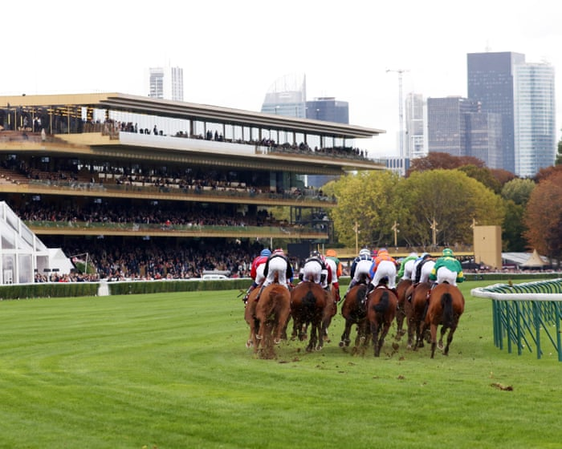

# Prix de l’Arc de Triomphe 2026 Longchamp horse racing updates – live

- Updates on the big race in Paris (3.
- 05pm), news and more Get in touch!
- Send your thoughts to Greg here 1.

## Story

1.09pm Qatar Prix Jean-Luc Lagardere preview The second two-year-old race on the card is often assumed to be the colts’ version of the Boussac, but it’s over seven furlongs rather than a mile and while the great majority of the field are colts, fillies are also eligible and Francis-Henri Graffard’s Amusingly is an interesting contender with the 4lb sex allowance at the bottom of the card. Aidan O’Brien’s Happily, in 2017, is the only filly to actually win this century, though, and as was the case in the opener, it is Joseph O’Brien, and not his father, who fields the likely favourite in Folsom Blues.

The son of Blue Point bolted up in the Group One National Stakes at the Curragh three weeks ago, finishing six lengths clear without being asked for maximum effort, and though a draw in stall 10 is not ideal, a repeat of that will make him hard to beat. That said, Folsom Blues has been beaten in three of his five starts to date, unlike Avec Toi, the likely second-favourite, who arrives with a perfect 4-from-4 record. He is stepping up from Group Three company but clearly brings considerable talent to the fray, though I’ll be more than happy to back Folsom Blues to beat him, not least because his latest rout was backed up by a strong time.

12.31pm Qatar Prix Marcel Boussac And they’re off for the opener on Arc day … Nevermindtherain is slowly away and Green Empress the favourite is in midfield … Spirit Tango leads at halfway … So Lovely is right there as they turn for home … Green Empress now delivers her challenge and will just hold on a very strong challenge from Data. sadly, Spirit Tango appeared to suffer a very bad injury during the race.

A dozen runners for the Arc meeting’s premier event for juvenile fillies, won last year by an Arc contender, Diamond Necklace. It’s a race where the visitors have enjoyed plenty of success in recent years but the home team have also managed to hold their own, with 10 wins for French stables in the last 20 years and the remainder shared between Ireland and Britain. Aidan O’Brien, needless to say, is the most successful raider from across the water, with six wins since 2005, but it is his son, Joseph, who fields the likely favourite in Green Empress, the runner-up behind his dad’s hugely impressive Sun Goddess in the Moyglare Stud Stakes last time.

- Source: Guardian
- Related: [[Max Verstappen wins chaotic F1 Bahrain GP in Malaysia after rain causes]], [[Modric ‘ashamed’ after 7-0 defeat by England; Republic of Ireland v]]

Back to [[Sport News]].
