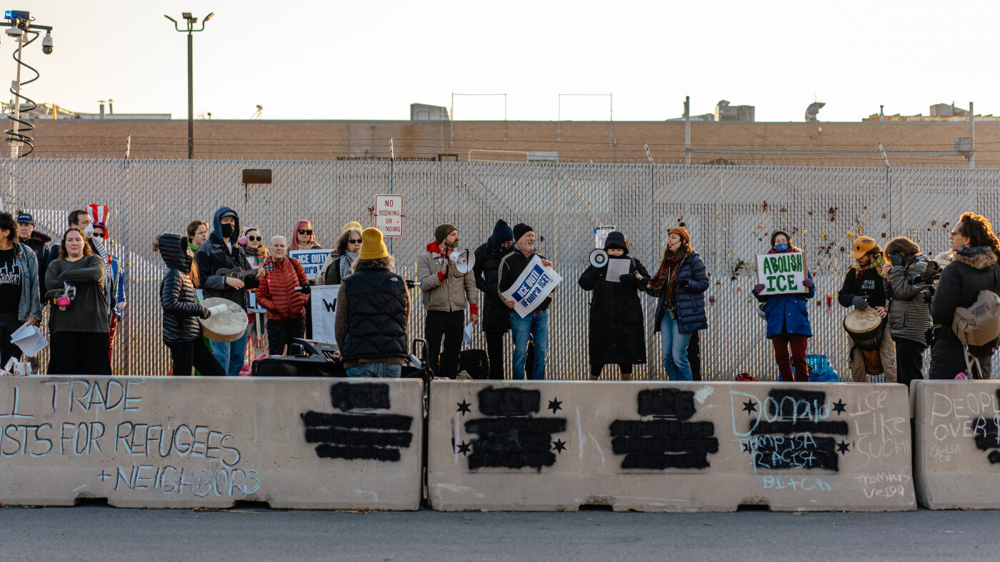

# Pro-Trump Influencer Benny Johnson is being sued for defamation by ICE

- The lawsuit says the prominent conservative podcaster falsely claimed the protesters were assaulting ICE officers during demonstrations at an ICE facility in Illinois last year.

## Story

Demonstrators gather within the "free speech zone" near an Immigration and Customs Enforcement processing and detention facility on October 31, 2025, in Broadview, Ill. Jamie Kelter Davis/Getty Images hide caption

Pro-Trump media figure Benny Johnson is being sued for defamation by protesters who say he falsely portrayed them as "left-wing terrorists" who had assaulted federal officers.

One plaintiff, Kyle Frankovich, had never heard of Johnson before the podcaster and online influencer posted video of Frankovich and a row of other protesters detained outside an ICE facility in Broadview, Ill. last October. "These individuals assaulted ICE officers as they were trying to clear out the area behind us over here," said Johnson in one video.

Johnson made the videos while embedded with then-Secretary of Homeland Security Kristi Noem and then Border Patrol Commander-at-Large Gregory Bovino.

- Source: NPR

Back to [[Business News]].
