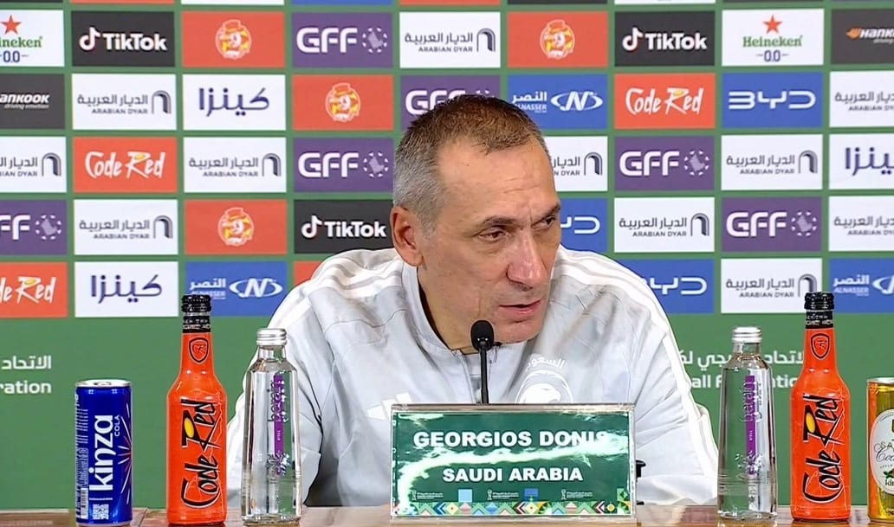

# Qatar coach Lopetegui praises ‘very strong’ Saudi fans after penalty

- Saudi Arabia's head coach Georgios Donis lauded his team's determination after securing a place in the Arabian Gulf Cup 27 final with a penalty shootout win over Qatar, emphasizing the impact of the home crowd.
- Despite their inability to score during regular time, Donis praised the players' performance, while Qatar's coach Julen Lopetegui expressed disappointment, acknowledging the strength of the Saudi side and its supporters.
- The final will see Saudi Arabia compete against the UAE on Tuesday.

## Story

JEDDAH: Saudi Arabia head coach Georgios Donis praised his players for their determination and performance after the Green Falcons secured a place in the Arabian Gulf Cup 27 final with a penalty shootout victory over Qatar.

Donis said the Saudi side produced an outstanding display despite being unable to score during the match, which was decided by penalties.

“I congratulate the players on their high-level performance and tenacity; they gave their all in a difficult match against an experienced opponent that plays with a solid defensive setup,” Donis said at the post-match press conference.

The Greek coach also highlighted the role of the Saudi supporters, who backed the team throughout the semifinal at home.

- Source: Arab News
- Related: [[Saudi institutes advance in global education rankings]], [[Al-Dahami grabs show jumping gold as Saudi Arabia ends Asian Games with]], [[‘Special course’ Liam Nolan claims maiden title in style at Abu Dhabi]]

Back to [[Sport]].
