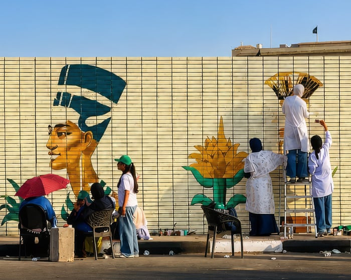

# Row erupts over Cairo mural depicting Tutankhamun and Nefertiti with

- Artwork created in Tahrir Square for Chinese president’s state visit to Egypt is painted over amid allegations it revived Afrocentric claims about pharaohs’ origins On the eve of the Chinese president Xi Jinping’s state visit to Cairo last month, the city authorities were busy removing a 66-metre-long mural from the esteemed guest’s line of sight.
- Depicting the Pharaoh Tutankhamun and Queen Nefertiti, the painting was among 40 murals commissioned to beautify the city for Xi’s arrival and was painted by a group of young volunteers, Rasmet Basma, in Tahrir Square.

## Story

Artwork created in Tahrir Square for Chinese president’s state visit to Egypt is painted over amid allegations it revived Afrocentric claims about pharaohs’ origins

On the eve of the Chinese president Xi Jinping’s state visit to Cairo last month, the city authorities were busy removing a 66-metre-long mural from the esteemed guest’s line of sight.

Depicting the Pharaoh Tutankhamun and Queen Nefertiti, the painting was among 40 murals commissioned to beautify the city for Xi’s arrival and was painted by a group of young volunteers, Rasmet Basma, in Tahrir Square.

But it drew a furious reaction for depicting the two historical figures with dark skin – angering those Egyptians who saw it as reviving Afrocentric claims about the 14th-century BCE pharaoh’s origins. The artwork vanished under fresh paint just hours before Xi landed.

- Source: Guardian
- Related: [[‘We are in a kind of war’ row over viral Amsterdam chip shop lands in]], [[Trump administration diverts human rights funds to push far-right agenda]], [[Libyan unity talks upended as warlord’s son linked to drone attacks on]]

Back to [[World News]].
