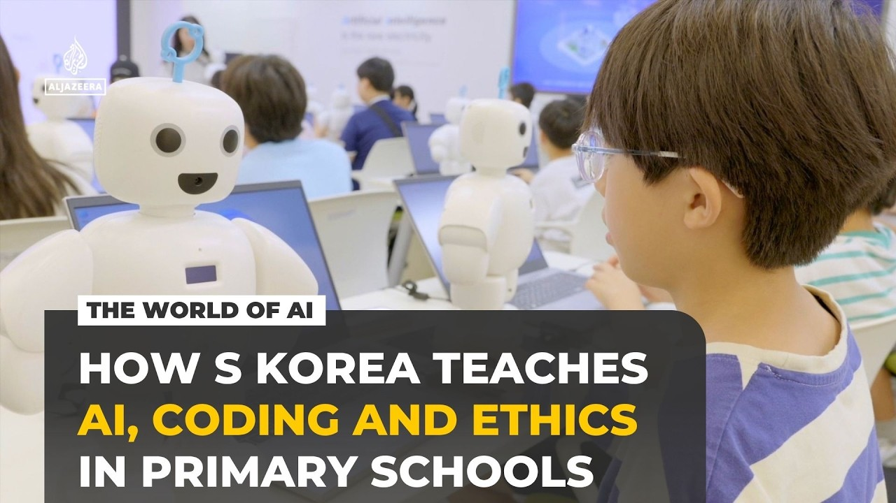

# S Korea teaches AI in primary schools in bid to become a global

[video](youtube:1z8riKjKD1w)

- South Korea is investing almost $900bn to rival China and the US as an AI superpower.
- To ensure enough home-grown talent, primary school children are taught robotics and how to code.
- They're also taught to question the ethics of the technology they're building.

- Source: Al Jazeera
- Related: [[How the China-US AI arms race is escalating The Dip Podcast]], [[China's AI plan is bigger than ChatGPT DW News]]

Back to [[Video News]].
