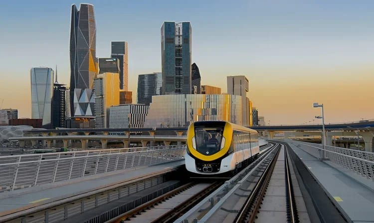

# Saudi Arabia charts a resilient fiscal course for 2027

- The Ministry of Finance has released the pre-budget statement for 2027, outlining the Kingdom’s fiscal outlook for the coming year and the medium term.
- The statement comes as Saudi Vision 2030 enters its final phase, focused on maximizing and sustaining its impact.
- This phase builds on an integrated framework of strategic priorities and financial and economic enablers to translate national goals into programs and initiatives that deliver lasting benefits.

## Story

The Ministry of Finance has released the pre-budget statement for 2027, outlining the Kingdom’s fiscal outlook for the coming year and the medium term.

The statement comes as Saudi Vision 2030 enters its final phase, focused on maximizing and sustaining its impact. This phase builds on an integrated framework of strategic priorities and financial and economic enablers to translate national goals into programs and initiatives that deliver lasting benefits. It also seeks to improve quality of life by providing efficient, high-quality essential services to citizens and residents, creating rewarding employment opportunities across the public and private sectors, and strengthening economic security in line with the Kingdom’s development aspirations.

Through its budget, the Kingdom aims to reinforce confidence in its fiscal policy and maintain sustainability amid global economic uncertainty. This approach is based on keeping debt at sustainable levels, maintaining substantial government reserves and maximizing the economic and social returns of public spending.

The budget also supports private sector stability and growth by increasing local content, strengthening supply chain resilience, improving the business and regulatory environment and expanding privatization opportunities. These measures are intended to help businesses manage geopolitical developments, absorb shocks and sustain operations.

- Source: Arab News
- Related: [[New food safety rules for ice cream shops in Kingdom]], [[Qatar coach Lopetegui praises ‘very strong’ Saudi fans after penalty]], [[Kingdom calls for global cooperation on child safety]]

Back to [[Opinion]].
