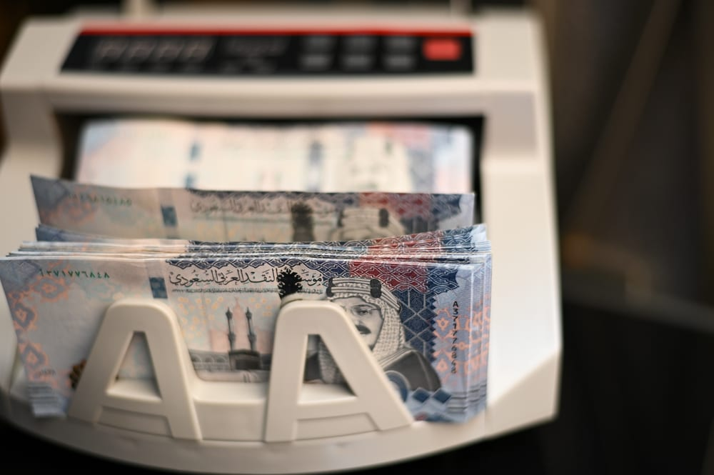

# Saudi Arabia opens October ‘Sah’ sukuk with 5 percent annual return

- RIYADH: Saudi Arabia opened subscriptions for its October “Sah” savings sukuk with a 5 percent annual return, giving individual investors a higher yield than the previous month’s offering.
- The subscription window opened at 10 a.
- 6, according to the National Debt Management Center, or NDMC.

## Story

RIYADH: Saudi Arabia opened subscriptions for its October “Sah” savings sukuk with a 5 percent annual return, giving individual investors a higher yield than the previous month’s offering.&nbsp;

The subscription window opened at 10 a.m. Saudi time on Oct. 4 and will close at 3 p.m. on Oct. 6, according to the National Debt Management Center, or NDMC. The October return is 20 basis points higher than the 4.80 percent offered in September.&nbsp;

The riyal-denominated, Shariah-compliant sukuk has a one-year saving period, with the annual return paid at maturity. The issuance is part of the NDMC’s 2026 calendar and reflects the Kingdom’s efforts to boost household savings and advance financial inclusion.&nbsp;

In a post on X, the NDMC said the minimum subscription is SR1,000 ($266), while the maximum is capped at SR200,000 per individual across the program period.&nbsp;

- Source: Arab News
- Related: [[Closing Bell Saudi stocks regain ground as TASI jumps 1.1 percent]], [[Saudi tourism facilities expand 18 percent as hospitality supply grows]], [[King Salman invites Qatar emir to GCC-EU Summit to be held in October]]

Back to [[Business]].
