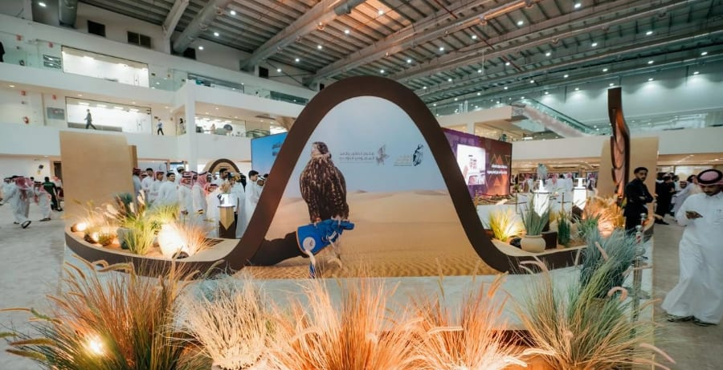

# Saudi exhibition traces kings’ bond with falconry through rare

- RIYADH: A display at the Saudi International Falcons and Hunting Exhibition 2026 is tracing the royal family’s long relationship with falconry, a pastime deeply rooted in Saudi culture, through rare photographs and historic artifacts spanning decades.
- The “Shalayel” display opens with the founder, King Abdulaziz, and includes his falcon’s perch, a photo of him with companions at his camp near Riyadh, and a 1938 picture of his falconers holding their birds.

## Story

RIYADH: A display at the Saudi International Falcons and Hunting Exhibition 2026 is tracing the royal family’s long relationship with falconry, a pastime deeply rooted in Saudi culture, through rare photographs and historic artifacts spanning decades.

The “Shalayel” display opens with the founder, King Abdulaziz, and includes his falcon’s perch, a photo of him with companions at his camp near Riyadh, and a 1938 picture of his falconers holding their birds.

A 1956 photograph shows King Saud with a falcon on his hand. Two images document King Faisal’s interest in the birds, one of him in his majlis with a falcon before him and another from 1972 with notes on his interest in rare falcons.

King Khalid appears in a 1976 photo from a hunting trip in Pakistan, one of several rare images, some shown publicly for the first time. The display also includes belongings of King Fahd and photos of him carrying a falcon on trips in northern Saudi Arabia and near Riyadh.

- Source: Arab News
- Related: [[Two Mongolian saker falcons fetch $147,000 at Riyadh hunting exhibition]], [[Saudi and Moroccan Derbies take Kings League MENA centerstage as Ultra]], [[Kuwaiti artist Aseel Al-Yaqoub wins Ithra Art Prize 2026]]

Back to [[Lifestyle]].
